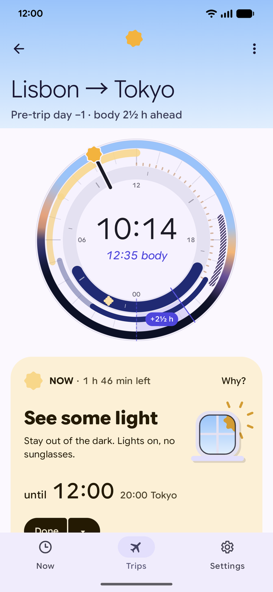
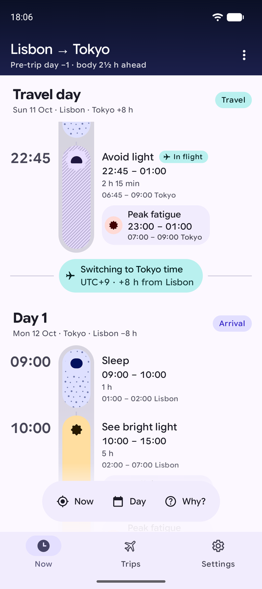
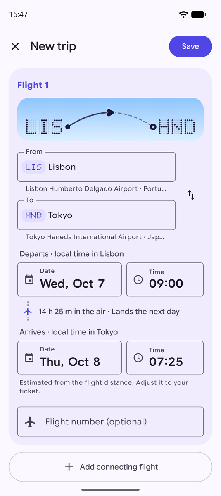
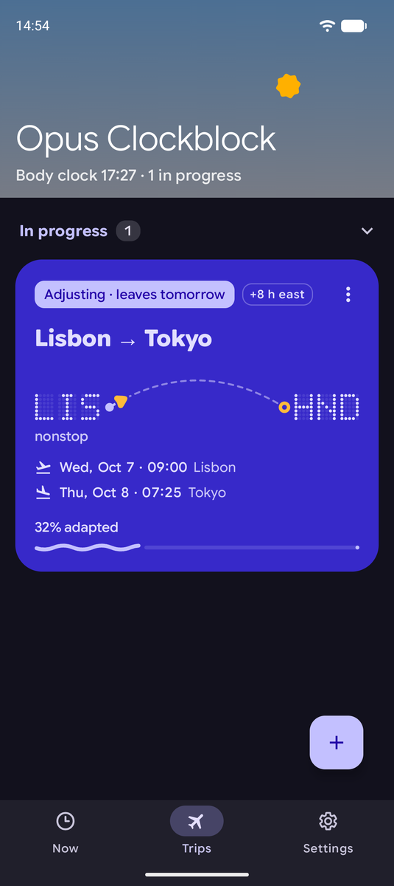
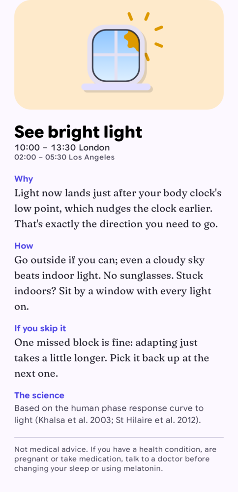
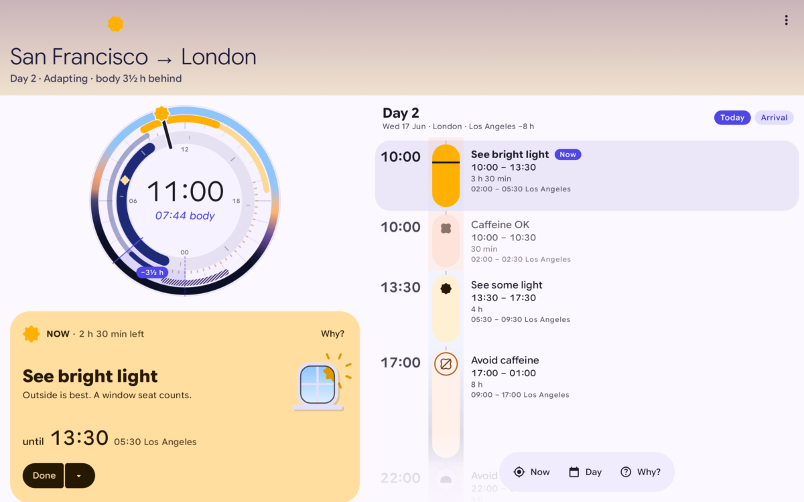

<p align="center">
  
</p>

<h1 align="center">Clockblock</h1>

<p align="center">
  <strong>A free, open-source jet lag planner for Android that works entirely offline.</strong><br />
  Clockblock schedules light, sleep and caffeine from published circadian research.
  It requires no account and has no network access or tracking.
</p>

<p align="center">
  <a href="https://github.com/rock3r/clockblock/actions/workflows/ci.yml"></a>
  <a href="LICENSE"></a>
  
  
  
</p>

<p align="center">
  
  
  
  
  
</p>

Clockblock builds a schedule to help your body clock adjust to destination time.
The plan gives start and end times for light, sleep, naps and caffeine.
Each block explains its purpose and cites research. All planning runs on your phone, without a paid service.

To use the app, read the [user guide](user-guide/README.md). To understand or change the code, start with the
[documentation index](docs/README.md).

## Features

- Enter connecting flights manually with offline airport and time-zone search.
- Compare local and estimated body clock time on the Two skies dial. Drag its needle to preview later advice.
- Read current advice and its end time on the Now card, with times in both zones.
  Record Done, Skipped or "Can't do this", and use Undo to clear the answer.
- Open "Why?" on any block for its purpose and sources.
- Set usual sleep, chronotype, adjustment rate, caffeine, in-flight sleep and pre-departure adjustment preferences.
  Melatonin remains off until you opt in.
- Keep your body clock on home time for short trips. Use "I'm delayed" to update flight times and rebuild the plan.
- Receive reminders before plan changes. During planned sleep, Clockblock sends only the wake-up reminder.
  A silent ongoing notification shows current advice and supports travel-day Live Updates.
- Read plans on Remote Compose home-screen widgets, including *Two clocks* and *Next up*.
- Use Night-safe to darken and dim the plan during sleep, light avoidance or body night without planned light.
  Widgets darken during sleep and light avoidance.
- Use phone, foldable and tablet layouts, including landscape and large text.
  Advice always has a text label. Static states retain meaning with "Remove animations" enabled.
- Back up and restore JSON files, or export a plan as an iCalendar (ICS) file.

<p align="center">
  
  
</p>

The *Two clocks* widget (left) draws the app's dial on your home screen. On a tablet (right), the plan
uses two columns: the day strip, the dial and the Now card beside the day's timeline.

## The science

The planner estimates the core body temperature minimum, a daily low point used to track body clock phase.
Light after that point moves the clock earlier. Light before it moves the clock later.
The plan schedules light and darkness for the chosen direction, based on the time difference and chronotype.
Daily shift limits follow rates reported in human studies. The planner schedules sleep, naps and caffeine around those shifts.

The Hannay 2019 mathematical model simulates adjustment with and without the plan.
Tests check plans against Hannay 2019 and Forger 1999.

The docs cite the research and list the planning rules and known limitations.

- [docs/science.md](docs/science.md): the research review, with references.
- [docs/algorithm.md](docs/algorithm.md): the exact rules, every parameter and the known limitations.
- [docs/planning-engine.md](docs/planning-engine.md): how the planner is wired into the app.

## Privacy

Clockblock omits the `INTERNET` permission and has **no network access**.
It has no accounts, analytics, ads, crash reporters or third-party service SDKs.
Trips and profiles stay in private app storage unless you export, share or transfer them.
Exports include backup and calendar files. Sharing sends a plan summary to another app.
Android can copy data through enabled system backups or phone-to-phone transfers.
See [Moving to a new phone](user-guide/settings-and-your-data.md#moving-to-a-new-phone).

## Not medical advice

Clockblock gives healthy adults general information based on published research. It cannot give medical advice and takes no measurements of your body.
Flight crew must not use it for duty schedules.
If you have a health condition, are pregnant, or take medication, consult a doctor before changing your sleep.

Melatonin suggestions are off by default. Turning them on shows a safety note first. Melatonin is a prescription
medicine in some countries, and you should check with a pharmacist or doctor before taking it.

## Build and test

You need JDK 21 and the Android SDK with platform 37.1. Create `local.properties` with your SDK path
(`sdk.dir=/path/to/Android/sdk`), then:

```sh
./gradlew :app:assemblePlayDebug               # debug APK (the Google Play build)
./gradlew :app:assembleOssDebug                # debug APK of the build for outside Google Play
./gradlew test                                 # all JVM and Robolectric unit tests
./gradlew :core:circadian:test                 # one module
./gradlew verifyRoborazziDebug                 # compare screenshots with the committed goldens
./gradlew :feature:plan:recordRoborazziDebug   # re-record goldens after an intended UI change
./gradlew :app:connectedPlayDebugAndroidTest   # end-to-end tests on a device or emulator
```

The `play` flavour requests exact-alarm access so reminders can arrive on the minute.
The `oss` flavour distributes outside Google Play and receives `USE_EXACT_ALARM` at installation.
Google Play restricts that permission to alarm and calendar apps.

The debug build needs no API keys, no backend and no signing setup. The app runs on Android 17 (API 37) and later.

The project uses test-first development, with roughly 1,100 JVM tests, 193 screenshot goldens and 22 end-to-end tests.
Continuous integration (CI) runs these suites on each pull request. See [docs/testing.md](docs/testing.md).

## Architecture

Clockblock uses a multi-module Gradle build.
The domain types and planner use plain JVM modules. The other modules depend on Android.

| Module | Kind | Purpose |
|---|---|---|
| `:core:model` | JVM | Domain types (`Trip`, `UserProfile`, `JetLagPlan`, `Advice`…) |
| `:core:circadian` | JVM | The jet lag planner and the Forger99 and Hannay19 model ports |
| `:core:data` | Android | Repositories (DataStore), offline airport search, plan cache, backup, ICS export |
| `:core:designsystem` | Android + Compose | Theme, type, colour, motion tokens, shapes, illustrations, the dial |
| `:core:notifications` | Android | Alarm scheduler, reminders, the Now notification and Live Update |
| `:core:testing` | Android | Test rules, fakes, screenshot helpers |
| `:feature:onboarding`, `:feature:trips`, `:feature:plan`, `:feature:settings` | Android + Compose | The screens |
| `:widget` | Android + Compose | Remote Compose widgets |
| `:app` | Application | Navigation 3 shell, adaptive layouts, Metro DI graph |

The build uses Android Gradle Plugin (AGP) 9 with built-in Kotlin, Kotlin 2.4 and JDK 21.
Jetpack Compose's alpha bill of materials (BOM) supplies Material 3 Expressive.
The app uses Navigation 3, [Metro](https://github.com/ZacSweers/metro) dependency injection, Remote Compose and DataStore with kotlinx-serialization.
Time handling uses `java.time` and IANA zone ids. Persistence stores zone ids rather than fixed offsets.

Read more:

- [docs/architecture.md](docs/architecture.md): modules, data flow, DI, navigation and the time-zone rules.
- [docs/surfaces.md](docs/surfaces.md): how reminders, the Now notification and the widgets stay in step.

## Design

- [docs/design.md](docs/design.md): product research and the visual identity ("Dusk Instrument"): colour, type
  (Google Sans Flex and Fraunces), shape language, illustrations and copy voice.
- [MOTION.md](MOTION.md): the motion language, in the format of
  [rock3r/android-ux-skills](https://github.com/rock3r/android-ux-skills). Entries are agent-drafted and tagged
  `OBSERVED` until a human ratifies them.
- [docs/motion-review-1.md](docs/motion-review-1.md): the first motion review.
- The icon family (launcher, themed and notification icons) is generated by
  [`tools/icon/gen_icon.py`](tools/icon/gen_icon.py).

## Easter eggs

The dial has hidden animations. Repeated taps on the version number unlock Opus mode.
The plan screen disables its hidden animations during sleep windows and when Reduce motion is on.

## Contributing

Issues and pull requests are welcome. See [CONTRIBUTING.md](CONTRIBUTING.md) for setup, conventions and how to
refresh the bundled airport dataset.

## Credits

- Science: the phase-response, melatonin and model literature cited in [docs/science.md](docs/science.md).
- Fonts: [Google Sans Flex](https://fonts.google.com/specimen/Google+Sans+Flex) and
  [Fraunces](https://github.com/undercasetype/Fraunces), both under the SIL Open Font License 1.1.
- Airport data: [OurAirports](https://ourairports.com/data/) (public domain) and
  [mwgg/Airports](https://github.com/mwgg/Airports) (MIT).
- Time zones: the [IANA tz database](https://www.iana.org/time-zones) (public domain), through `java.time`.
- Motion review process: [rock3r/android-ux-skills](https://github.com/rock3r/android-ux-skills) (Apache-2.0).
- The trip editor's ticket shape and the route globe are adapted from Chris Sinco's
  [Prime Meridian](https://github.com/c5inco/m3e-vibes/tree/main/apps/prime-meridian) (Apache-2.0).
- Globe land: [Natural Earth](https://www.naturalearthdata.com) 1:110m (public domain).

Full attributions are in [NOTICE](NOTICE) and in the app under About → Licences.

## Licence

Copyright 2026 Sebastiano Poggi and contributors. Licensed under the [Apache License, Version 2.0](LICENSE).
Bundled fonts and data keep their own licences; see [NOTICE](NOTICE).
