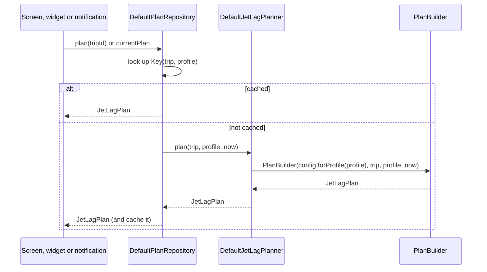
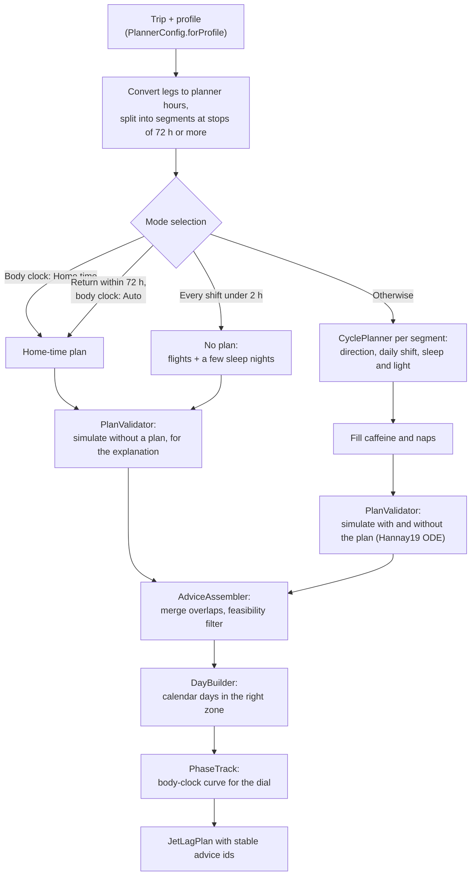

# The planning engine

The planner builds a light, sleep, nap and caffeine schedule from one trip and profile.
It adds melatonin only after opt-in. The schedule covers pre-departure adjustment through estimated adaptation.
The `:core:circadian` module uses plain Kotlin without Android code, input/output operations or clock reads.
Identical trip and profile inputs produce identical advice.

[algorithm.md](algorithm.md) defines the engine's thresholds, formulas and limitations.
[science.md](science.md) gives the supporting research.
The sections below describe its app integration and processing stages.

## Where it sits

The app talks to the planner through one interface,
[`JetLagPlanner`](../core/circadian/src/main/kotlin/dev/sebastiano/clockblocker/opus/core/circadian/JetLagPlanner.kt).
`AppGraph` binds it to
[`DefaultJetLagPlanner`](../core/circadian/src/main/kotlin/dev/sebastiano/clockblocker/opus/core/circadian/DefaultJetLagPlanner.kt).
Only [`DefaultPlanRepository`](../core/data/src/main/kotlin/dev/sebastiano/clockblocker/opus/core/data/plan/DefaultPlanRepository.kt)
calls it. Screens, widgets and notifications read plans through that repository.

The cache key contains the complete trip and profile. Changing either creates a new plan.
The `now` argument sets `generatedAt` without affecting advice.
[architecture.md](architecture.md#the-plan-cache) explains shared computations and cache limits.

## When a plan is recomputed

| Event | New plan? | Why |
|---|---|---|
| The user edits a trip (legs, times, return flight, body clock choice) | Yes | The trip is part of the cache key |
| The user taps "I'm delayed" in the editor | Yes | The delay moves the flight times, so the trip changes |
| The user changes the profile (home zone, sleep, chronotype, tools, effort, melatonin) | Yes | The profile is part of the cache key |
| The user marks advice as Done, Skipped or "Can't do this" | No | Logs are stored separately and only change what the UI shows |
| The user changes theme, reminders or other settings | No | Settings are not planner inputs |
| Time passes, or the user lands in a new zone | No | The plan already covers every day; `currentPlan` just picks the right trip and moment |

## The stages

[`PlanBuilder`](../core/circadian/src/main/kotlin/dev/sebastiano/clockblocker/opus/core/circadian/engine/PlanBuilder.kt)
runs the stages below in order. The first step picks one of three modes. Only "adapt" runs the full cycle
planner.

The builder converts flights to planner hours and splits long stopovers into segments.
It checks modes in order: explicit Home time, shifts below two hours, then an Auto return within 72 hours.
Small shifts produce flight markers and a few sleep nights. Explicit Home time and short Auto trips use home-time schedules.
Other trips use the cycle planner. All modes share the final assembly stages.

| Stage | Code | What it does | Rules in algorithm.md |
|---|---|---|---|
| Configuration | [`PlannerConfig.kt`](../core/circadian/src/main/kotlin/dev/sebastiano/clockblocker/opus/core/circadian/PlannerConfig.kt) | Turns effort level and tools into planner parameters | [§5](algorithm.md#5-parameters), [§5.1](algorithm.md#51-intensity-and-preferences-plannerconfigforprofile) |
| Mode selection | `PlanBuilder.build()` | Home time, no plan, or adapt | [§3](algorithm.md#3-mode-selection) |
| Cycle planning | [`CyclePlanner.kt`](../core/circadian/src/main/kotlin/dev/sebastiano/clockblocker/opus/core/circadian/engine/CyclePlanner.kt) | Picks advance or delay, shifts sleep and light windows day by day around the body-clock low point | [§4](algorithm.md#4-decision-procedure-adapt-mode) |
| Validation | [`PlanValidator.kt`](../core/circadian/src/main/kotlin/dev/sebastiano/clockblocker/opus/core/circadian/engine/PlanValidator.kt), [`ode/`](../core/circadian/src/main/kotlin/dev/sebastiano/clockblocker/opus/core/circadian/ode) | Simulates the light schedule with a published model to estimate days to adapt, with and without the plan | [§6](algorithm.md#6-estimates-and-validation-13) |
| Card assembly | [`AdviceAssembler.kt`](../core/circadian/src/main/kotlin/dev/sebastiano/clockblocker/opus/core/circadian/engine/AdviceAssembler.kt) | Merges overlapping advice, resolves conflicts, drops or trims advice that is impractical | [§4.1](algorithm.md#41-card-assembly-and-the-feasibility-filter) |
| Calendar days | [`DayBuilder.kt`](../core/circadian/src/main/kotlin/dev/sebastiano/clockblocker/opus/core/circadian/engine/DayBuilder.kt) | Splits the plan into days, each in the zone the user is in that day | [§4](algorithm.md#4-decision-procedure-adapt-mode) |
| Phase track | [`PhaseTrack.kt`](../core/circadian/src/main/kotlin/dev/sebastiano/clockblocker/opus/core/circadian/engine/PhaseTrack.kt) | The body-clock curve that the dial and the "body 3½ h behind" header read | [§4.2](algorithm.md#42-phase-trajectory) |

`PlanBuilder.stableId` hashes the trip id, advice type, day index and same-type position using SHA-256.
It uses the first eight hash bytes as the advice id.
Card position determines identity. Content changes affect identity only when they change that position.

- Recomputing identical inputs preserves every id, check-in, snooze and reminder deduplication record.
  Re-exporting the calendar can therefore update existing events.
- Changing only a time or reason preserves identity while the day and same-type position stay unchanged.
  The advice log and calendar event stay attached. The planner counts same-type cards by start time.
- Adding or removing an earlier same-type card shifts later positions that day.
  Their ids and attached logs can then refer to different advice.

## Body clock choice

The trip editor's "Body clock" setting maps to `Trip.strategyOverride`:

| Editor choice | Override | Effect |
|---|---|---|
| Auto | none | The planner decides. A return within 72 hours of arrival means home time. |
| Adapt | `Adapt` | Always adapt, even on a short trip (unless every shift is under 2 hours) |
| Home time | `StayOnHomeTime` | Always stay on home time |

## Testing the engine

Tests compare this Kotlin port byte for byte with Python reference output.
They check both model ports against published fixtures and generate hundreds of itineraries across unusual zones and daylight-saving changes.
Properties require stable unique ids, no exceptions and no conflicting overlaps, such as sleep with light exposure.
The 67 engine tests run on the JVM in seconds.
[algorithm.md §6.1](algorithm.md#61-test-coverage) lists coverage; [testing.md](testing.md) gives commands.
