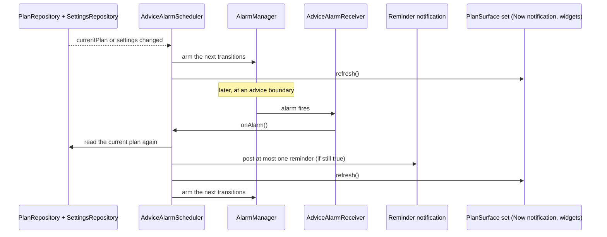
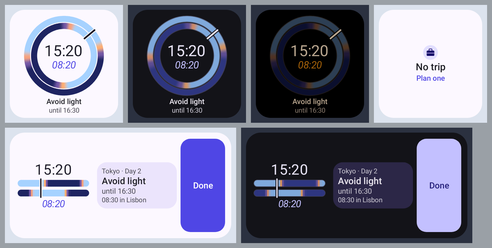
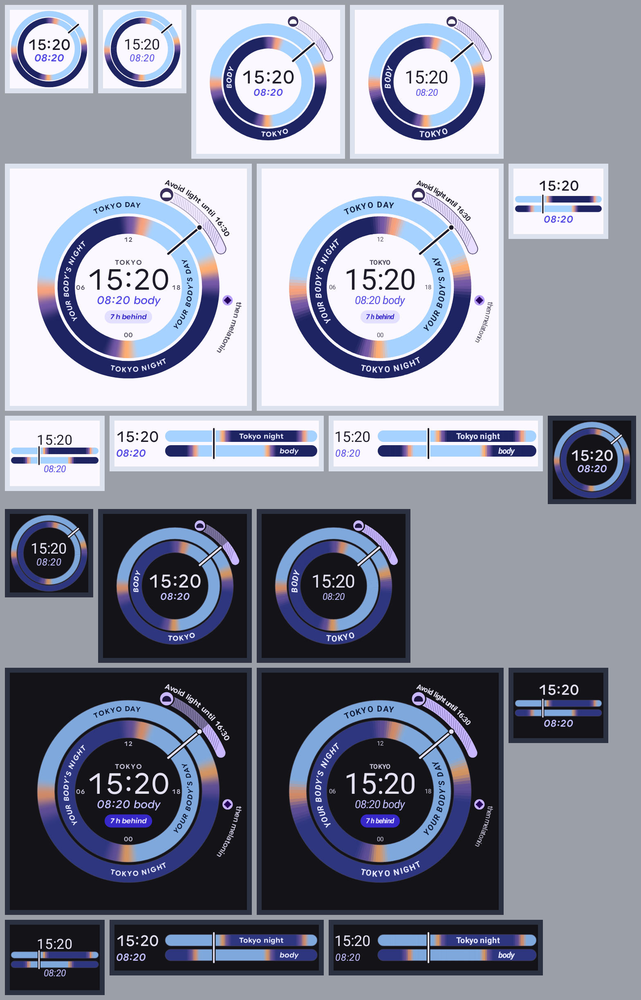
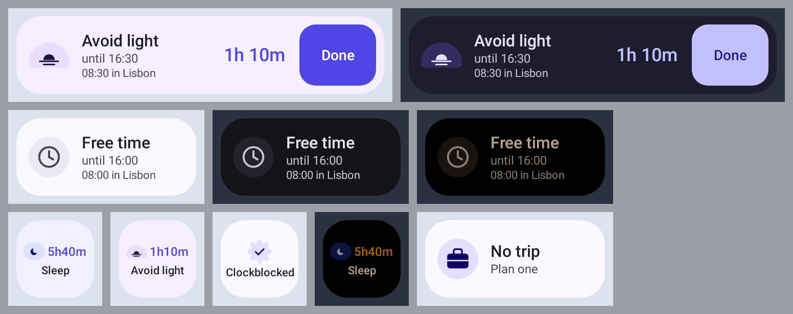
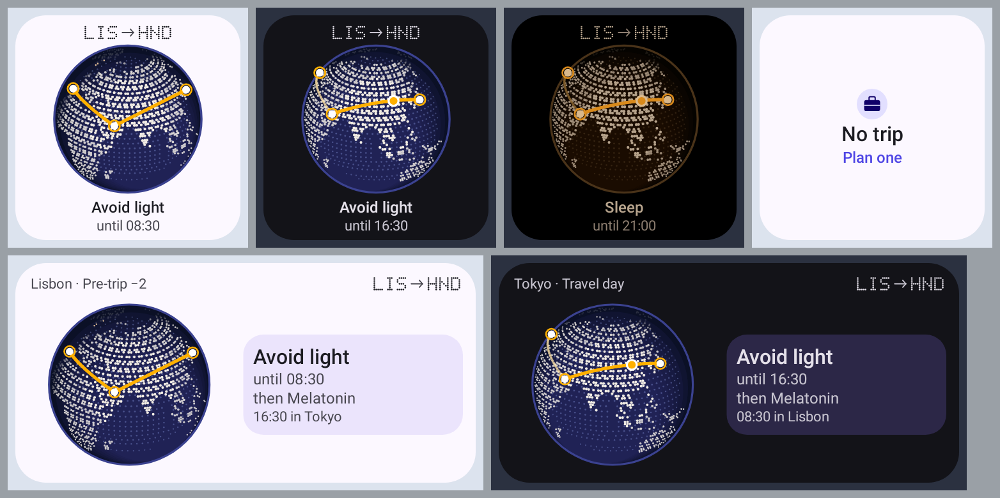
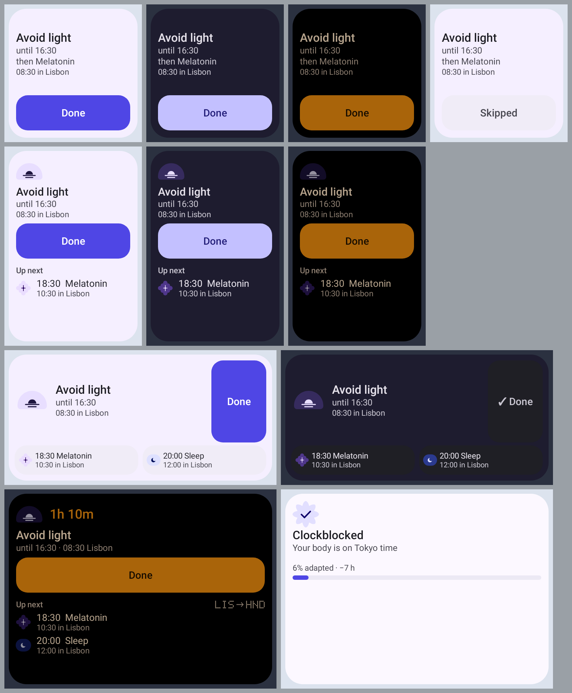
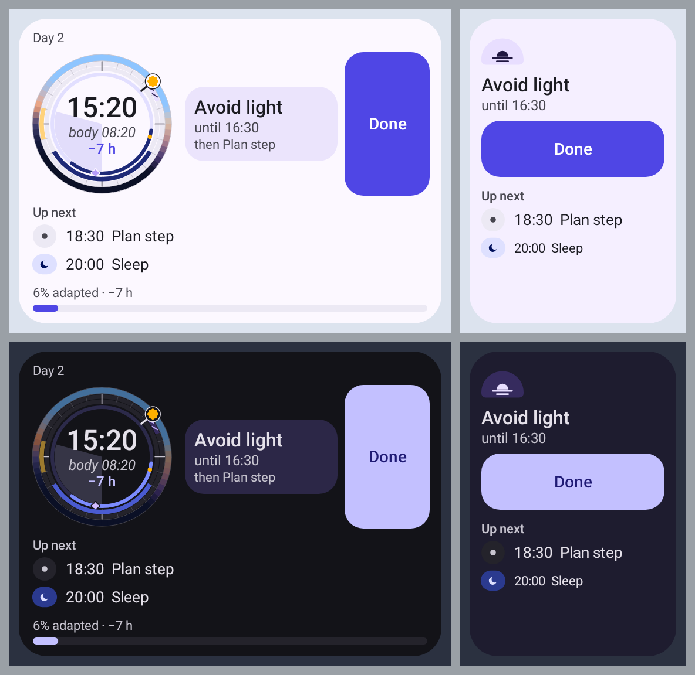
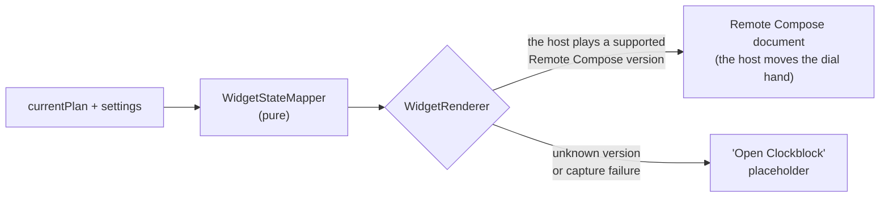

# Surfaces: notifications and widgets

The plan appears outside the app through the ongoing Now notification, advice reminders and three home-screen widgets.
The widgets are *Two clocks*, *Next up* and *Route globe*.

One scheduler controls them all. At each advice boundary, it reads the current plan, posts at most one reminder and refreshes every surface.
The surfaces agree after each refresh. A delayed alarm can leave them behind the app between refreshes (see [The scheduler](#the-scheduler)).

- [The scheduler](#the-scheduler) controls alarms and refreshes.
- [The Now notification](#the-now-notification) shows advice and actions.
- [Widgets](#widgets) show clocks, advice and routes.
- [Permissions](#permissions) control reminder delivery.

The code is in `:core:notifications` and `:widget`. The shared contract,
[`PlanSurface`](../core/data/src/main/kotlin/dev/sebastiano/clockblocker/opus/core/data/PlanSurface.kt), is in
`:core:data`: `suspend fun refresh()`, plus `hasPlacedGlobe` and `refreshGlobe()` for the route globe's own tick.

## The scheduler

[`AdviceAlarmScheduler`](../core/notifications/src/main/kotlin/dev/sebastiano/clockblocker/opus/core/notifications/AdviceAlarmScheduler.kt)
starts from `ClockblockApplication`. It watches `currentPlan` and the settings. When either changes, it re-arms its
alarms and refreshes every surface.

When an alarm fires, the scheduler reads the plan again. It checks whether the reminder still applies, refreshes the surfaces and schedules the next alarms.

The scheduler uses these timing rules:

- It schedules at most 8 alarm times, each with one or more transitions. It also schedules a pending snooze and 15-minute progress updates during Live Updates.
  With reminders on, it schedules the next body-clock header change. It also schedules the next widget dial refresh (`TransitionPlanner.nextDialRefresh`).
  Widgets capture the blocks once and then move only the hand. Two events require a new capture:
  - `nextDialEntry` refreshes 15 hours before a block starts. This allows an hour for a clock change within the dial's 16-hour future range.
    Without this refresh, a block outside that range would remain absent until it starts.
  - `nextMomentEnd` refreshes a minute after melatonin. Without this refresh, the widget would keep highlighting the moment until a later alarm.

  Dial refreshes skip Sleep and Nap windows because wake-up refreshes everything.
  A moment starting exactly at bedtime is an exception. Its alarm highlights it, so its end refresh runs one minute into sleep.
- A placed *Route globe* widget gets a separate alarm (`TransitionPlanner.nextGlobeRefresh`). It updates the traveller marker and the day-night boundary.
  It runs every 15 minutes in flight and hourly on the ground.
  This schedule starts a day before the first departure and ends a day after the last landing.
  Outside that range, the globe follows normal plan boundaries. A distant trip schedules one alarm at the range's start.
  The globe uses a non-wakeup `RTC` alarm with a 10-minute `setWindow`. The phone delivers it when it next wakes, such as when the screen turns on.
  It refreshes only globe widgets through `PlanSurface.refreshGlobe`, posts no reminder and schedules the next update.
- When the user allows exact alarms (`SCHEDULE_EXACT_ALARM`), it uses `setExactAndAllowWhileIdle`. Without that
  permission, it arms each instant twice:
  - a 10-minute `setWindow`, which keeps reminders within 10 minutes while the phone is awake. It isn't
    allow-while-idle, so Doze holds it until a maintenance window, which can be hours away overnight.
  - a second alarm with `setAndAllowWhileIdle` for the same instant (request code `200 + slot`). Doze allows this inexact alarm through, usually within an hour.
    Android gives no upper time limit. Battery Saver, app standby buckets and the allow-while-idle quota can delay it further.

  Inexact alarms can arrive late and out of order (an instant's silent Start before the reminder due 15 minutes
  earlier). [`HandledAlarms`](../core/notifications/src/main/kotlin/dev/sebastiano/clockblocker/opus/core/notifications/HandledAlarms.kt)
  stores scheduled instants, overdue undelivered instants from earlier schedules, and handled instants.
  Each delivery claims all due instants, selects reminders from them and replaces the remaining schedule.
  A duplicate delivery refreshes and reschedules without repeating a reminder.
  Rescheduling clears handled instants later than the current time. This preserves reminders after the user corrects a clock that was ahead.
  In Doze, reminders usually arrive within about an hour. Granting exact access cancels the second alarms when the scheduler next reschedules.
- Reminders show absolute times ("until 16:30"), so a late alarm never shows something false.
  [`ReminderSelector`](../core/notifications/src/main/kotlin/dev/sebastiano/clockblocker/opus/core/notifications/schedule/ReminderSelector.kt)
  drops any reminder that is no longer true when it fires.

### Which boundaries get an alarm

[`TransitionPlanner`](../core/notifications/src/main/kotlin/dev/sebastiano/clockblocker/opus/core/notifications/schedule/TransitionPlanner.kt)
is a pure function that turns a plan into a list of transitions. All the timing rules are there, with unit
tests.

| Transition | When | Makes a sound? |
|---|---|---|
| Upcoming | The reminder lead time ("How early" in Settings, 15 minutes by default) before a window starts | Yes |
| Start | A window starts | No, surfaces switch silently |
| End | A window ends | No |
| WakeUp | A Sleep or Nap window ends | Yes |
| Moment | A one-off advice is due (melatonin) | Yes |
| Flight take-off or landing | The flight times | No, they refresh the surfaces silently (and drive the travel-day Live Update) |

The rules that protect sleep and keep things quiet:

- Nothing fires strictly inside a Sleep or Nap window. A window that starts while the user should be asleep gets
  no reminder. The sleeper is woken once, by the WakeUp transition.
- Optional naps ("Nap if you're tired") don't silence anything, because they can be skipped.
- With reminders turned off, only the silent transitions remain, so widgets still update.
- Duplicate advice and transitions at the same instant are merged into one alarm.
- Only one reminder is visible at a time. It reuses one notification id. If several reminders are due at once,
  the most important one leads and the others are listed on an extra line ("Also: …").

### What resets the schedule

The system clears alarms on reboot and the plan's meaning changes when the clock or zone changes.
`ScheduleResetReceiver` in
[`Receivers.kt`](../core/notifications/src/main/kotlin/dev/sebastiano/clockblocker/opus/core/notifications/receiver/Receivers.kt)
listens for these broadcasts and re-syncs everything:

| Broadcast | Why |
|---|---|
| `BOOT_COMPLETED` | Alarms don't survive a reboot |
| `TIMEZONE_CHANGED`, `TIME_SET` | The user landed, or the clock was corrected |
| `MY_PACKAGE_REPLACED` | The app was updated |
| `LOCALE_CHANGED` | Notification text and channel names must change language |
| `SCHEDULE_EXACT_ALARM_PERMISSION_STATE_CHANGED` | Switch between exact and windowed alarms |

## The Now notification

[`NowNotificationSurface`](../core/notifications/src/main/kotlin/dev/sebastiano/clockblocker/opus/core/notifications/NowNotificationSurface.kt)
shows one quiet, ongoing notification with the current advice and its end time.

The notification uses `DecoratedCustomViewStyle` with app content. Android draws the icon, body-clock header, expand button and actions.
Supported phones play a Remote Compose document (#49). Other phones use classic `RemoteViews` layouts.

### Remote Compose content

`:widget` owns the documents and shares widget state, text, fitting and glyphs. It contributes them through Metro as
[`NowNotificationContent`](../core/notifications/src/main/kotlin/dev/sebastiano/clockblocker/opus/core/notifications/NowNotificationContent.kt)
([`RemoteNowNotificationContent`](../widget/src/main/kotlin/dev/sebastiano/clockblocker/opus/widget/RemoteNowNotificationContent.kt),
documents in [`NowNotificationRemote.kt`](../widget/src/main/kotlin/dev/sebastiano/clockblocker/opus/widget/rc/NowNotificationRemote.kt)).
This keeps `:core:notifications` independent of `:widget`.
`WidgetStateMapper.forNowNotification` builds documents from the notification's `NowState`, keeping advice and actions consistent:

| | Collapsed (48 dp) | Expanded (wraps its content, at most 252 dp) |
|---|---|---|
| Label and time | The headline's glyph beside "See some light" and "until 19:00 · 11:00 in Los Angeles" | Same, with a larger glyph; the line may wrap after a "·" |
| Progress | — | A bar from the block's start to its end, and the time left ("1h 22m") |
| Next | — | "Next: Avoid light at 23:30 · 15:30 in Los Angeles", with its glyph |

The until line always includes the other zone's time. It tries shorter place names, then the airport code, and disappears if none fits.
A logged headline starts with its outcome: "✓ Done · until 19:00 · …".
In a gap, the label says "Free time" and gives its end time. The next row says "Next: Sleep" without repeating the times.

The notification actions handle Done for accessibility and automation. The document has no Done button.
The bar and countdown use the notification panel's clock without reposting.
Each `themedColor` has light and dark values. SystemUI reapplies the views after a theme change, so the document repaints without reposting.
Notifications have no Night-safe theme.

The main region opens the plan and supplies a spoken description. It includes both zones' times, the outcome, time left and next advice.
The notification also sets its title and text for accessibility, the ticker, wearables and automation.

`NowNotificationSurface` automatically uses classic content if the player supports no document version, building or rendering throws, `notify` rejects it, or SystemUI removes it.

SystemUI inflates notifications after `notify` returns. It can silently cancel a notification that fails to inflate.
The platform documents an `IllegalArgumentException` for `DrawInstructions` inside another `RemoteViews`, as notification templates require. Versions 37.0 and 37.1 do not enforce this restriction there.

Five seconds after posting, the surface checks whether the notification remains visible. If it disappeared without a later post, the surface records `Build.FINGERPRINT` and posts classic content.
Remote Compose stays disabled until a system update. Swiping away the notification within those five seconds also disables it.

**Classic content**
([`NowNotificationViews`](../core/notifications/src/main/kotlin/dev/sebastiano/clockblocker/opus/core/notifications/NowNotificationViews.kt),
layouts `notif_now_collapsed` / `notif_now_expanded`) reads top to bottom:

| | Collapsed (48 dp) | Expanded |
|---|---|---|
| Glyph | — (the label needs the room at large font sizes) | The headline's glyph on its colour chip |
| Label and time | "See some light" … "until 19:00" | "See some light", then "until 19:00 · 11:00 Los Angeles" |
| Progress | A bar from the block's start to its end | Same |
| Alongside | — | "Also now: Avoid caffeine until Sun 02:00 · 18:00 Los Angeles", up to two blocks, each with its own end |
| Next | — | "Next: Avoid light at 23:30 · 15:30 Los Angeles" |
| Tip | — | The headline's tip, in italics |

The until time belongs to the headline, matching the app's Now card and widgets (#43).
"Also now" lists overlapping active blocks with their own end times. "Next" shows the next block, including one that starts before the headline ends.

In a gap, the title says "Nothing right now" and the line names the next advice.
The expanded view shows a neutral clock chip. Neither view shows a progress bar.
The collapsed view uses local times only. The expanded view adds the other zone after every time, using no-break spaces to keep it together.

The small icon uses the app's Horizon mark with the headline accent (`nowNotificationAccent`).
It appears in the status bar, always-on display and older notification headers. Newer headers show the app icon.
The advice glyph appears in custom content or as the large icon on lock-screen notifications, reminders and Live Updates.
Classic chips and bars use the design system's light and dark advice colours from
[`NotificationPalette`](../core/notifications/src/main/kotlin/dev/sebastiano/clockblocker/opus/core/notifications/NotificationPalette.kt).
`NotificationPaletteTest` checks that the palettes agree. Android selects colours for the notification panel's theme.
System notification text styles follow dark mode and font size.
TalkBack reads text labels and skips adjacent glyphs. It skips the bar because the until time gives the same information.

The classic bar moves when the notification rebuilds at plan boundaries or on a five-minute progress alarm (`NotificationIntents.progressTick`).
This inexact, non-wakeup `AlarmManager.RTC` alarm waits until a sleeping phone wakes. It updates the bar and any "Also now" changes during sleep.
The scheduler cancels it when the notification is hidden, its channel is blocked, Remote Compose supplies content, or a Live Update replaces it.
The notification omits `setWhen` because Android would display that time in the device's zone.

The lock-screen version always uses the standard big-text template and an advice chip as its large icon.
It formats the headline, until time, "Also now", "Next" and tip, subject to the [redaction rules](#lock-screen-redaction).

It is hidden when reminders are off, notifications are blocked, no plan is in progress, or the user snoozed it.
[`NowState.kt`](../core/notifications/src/main/kotlin/dev/sebastiano/clockblocker/opus/core/notifications/now/NowState.kt)
picks the headline:

1. Sleep beats everything, then Nap, then "Nap if you're tired".
2. Otherwise, the active window with the highest priority (bright light comes before caffeine, and so on).
3. A flight is the headline only when nothing else is active.

Melatonin is never the headline. It gets its own reminder.

The Now notification has three actions: Done, "Can't do this" and "Snooze 15 min". It shows them only while the
headline isn't a flight and hasn't been answered yet. Once the headline has an outcome, it shows a single Undo
action instead, which clears that outcome (`AdviceLogRepository.clear`) and refreshes every surface, widgets
included. Reminders get a set of actions that depends on their kind (`NotificationFactory.reminder`):

| `ReminderKind` | Actions |
|---|---|
| `Upcoming`, `Snoozed` | "Can't do this", "Snooze 15 min" |
| `Moment` (melatonin) | Done, "Snooze 15 min" |
| `WakeUp` | none |

`AdviceActionReceiver` logs the action and refreshes the surfaces. Snoozing hides the Now notification for 15 minutes.
It then posts a `Snoozed` reminder only if the advice still applies.
`ReminderSelector.snoozed` returns `null` after the block ends, or after melatonin's reminder window passes.
The snooze state lives in
[`SnoozeStore`](../core/notifications/src/main/kotlin/dev/sebastiano/clockblocker/opus/core/notifications/SnoozeStore.kt).

All notification times use the plan's local zone, including reminders, Live Updates and status chips. `JetLagPlan.localZoneAt` in
[`PlanZones.kt`](../core/circadian/src/main/kotlin/dev/sebastiano/clockblocker/opus/core/circadian/PlanZones.kt)
returns the zone of the plan day containing the instant.
The travel day keeps the departure zone until the last landing, then uses the next day's zone.
This also applies after an evening arrival when the travel day continues until midnight.
Outside the plan, it uses the first or last day's zone.

`secondaryZoneFor` selects the destination, or home once local time uses the destination's zone.
It omits the secondary zone when the current UTC offsets match.
The plan screen (`PlanMoment` and the rail) and widgets (`WidgetStateMapper`) use the same functions. `NotificationClock` has no zone.

The header shows the body-clock offset from local time, rounded to half an hour.
Examples include "Body 3½ h behind", "Body 2 h ahead" and "Body clock in sync" for offsets under 30 minutes.
An offset avoids the minute-by-minute updates a body time would need.

`BodyClockHeader.nextChange` scans 36 hours ahead in 10-minute steps. It reads the local zone at each step, including plan-day zone changes.
The scheduler adds an alarm when the rounded offset next changes and refreshes the header through
[`NotificationTextFormatter.bodyClock`](../core/notifications/src/main/kotlin/dev/sebastiano/clockblocker/opus/core/notifications/text/NotificationTextFormatter.kt).

### Lock-screen redaction

Every Now notification and reminder includes a public version from the same formatter with `redact = true`.
It removes flight numbers, routes, secondary-zone times, tips and "Also now".
It labels melatonin "Plan step" with a neutral icon and moments "Unlock to see details". Times and block kinds remain.

The public version has no actions because action combinations can identify advice: Done with Snooze identifies melatonin.
It uses the standard big-text template and an advice chip as its large icon. Custom views contain private text.

"Hide details on the lock screen" (`AppSettings.hideLockScreenDetails`) sets visibility to `VISIBILITY_PRIVATE`.
Android then shows the public version on secure lock screens when system settings hide sensitive content.
The setting defaults to off, with public visibility and full text.

While enabled, `AdviceAlarmScheduler` checks each plan or settings emission for a visible reminder without a public version. This includes the first emission after restart.
`ReminderNotifier.redactShowing` rebuilds it under the reminder-posting lock, preserving its timeout without another alert.
It withdraws reminders from earlier processes because their original text is unknown.
[Lock-screen widgets](#lock-screen-widgets) use the same setting.

### Live Update on travel days

The Now notification becomes a Live Update during the travel day. It uses
`Notification.ProgressStyle`, with coloured segments for advice blocks and points for take-off and landing.
[`TravelPlanner.kt`](../core/notifications/src/main/kotlin/dev/sebastiano/clockblocker/opus/core/notifications/now/TravelPlanner.kt)
defines the travel window as 3 hours before the first departure to 2 hours after the last arrival.
It never has custom content, Remote Compose or classic: Android only promotes notifications without custom views.

Android requires Live Updates to be ongoing, user-started and time-sensitive.
The app shows one only inside the travel window while an advice window is active. A flight marker alone does not qualify.
Otherwise, the app shows the normal ongoing notification. Both use the same notification ID, so the notification changes in place.

`NotificationTextFormatter.travelSubText` adds the route and travel phase before the body-clock offset:

- Before departure: "LHR → HND · Departs 11:30 · Body 8 h behind".
- Between legs: "Next flight HH:MM".
- In flight: "Lands HH:MM".
- After the last arrival: "Landed".

Phases use absolute times because sleep windows prevent countdown refreshes.
`TripRepository` supplies the origin and destination codes through `TripRoute`. The public version omits the route.

### Channels

Users can control each channel in Android settings. The channels are created in
[`NotificationChannels.kt`](../core/notifications/src/main/kotlin/dev/sebastiano/clockblocker/opus/core/notifications/NotificationChannels.kt).

| Group | Channel | Sound | Used for |
|---|---|---|---|
| Reminders | Light | Yes | When to seek bright light and when to avoid it |
| Reminders | Sleep & energy | Yes | Bedtime, naps, wake-ups and low-energy warnings |
| Reminders | Supplements & caffeine | Yes | Melatonin (only if turned on) and caffeine timing |
| Ongoing | Travel day (live) | No | The travel-day Live Update |
| Ongoing | Now | No | The ongoing Now notification |

## Widgets

The `:widget` module provides three widgets. All three can be placed on the home screen. All three declare the `keyguard`
category too, which matters on tablets and in hub mode. On phones, the lock-screen view of the plan is the Now
notification.

The *Two clocks* widget follows the shared [dial spec](design.md#a-two-skies-dial--hero-of-plan-screen-widget-celebration).
It uses *Two skies* in 2×2, 2×3 and 4×3 layouts.
It uses *Two strips* in 1×1, 2×1, 4×1 and landscape 2×2 layouts, where a round dial would be too small.
Local time appears on the outer sky or top strip. Body time appears on the inner sky or bottom strip.
The needle or now line follows local time. Without a trip, every size says "No trip" and "Plan one".

[`WidgetDial`](../widget/src/main/kotlin/dev/sebastiano/clockblocker/opus/widget/rc/WidgetDial.kt) lays out the dial at the layout's minimum size.
[`drawDialSpec`](../widget/src/main/kotlin/dev/sebastiano/clockblocker/opus/widget/rc/RemoteDialSpec.kt) replays it
into the Remote Compose canvas at the actual size.
The region's size in dp sets the detail level: glance, simple or full, using the app's rules.
Most widget dials use glance detail: both skies, the needle and both times. Wide rows use simple detail, adding bar labels and jet lag.

The dial uses the widget face colour and system font. Remote Compose cannot load the app's font.
Dial text stays at least 7 dp tall. The AM/PM marker keeps that size while the digits shrink.
Ring labels, bar labels, advice names and jet lag stay at least 10 sp and follow font scale.
Labels disappear if they cannot fit their ring or bar at that size.

The strips keep local time paired with the top bar and body time with the bottom bar. The jet lag pill disappears before body time.
Smaller readouts use the same minimum: body time, "in sync" and AM/PM.
When space runs out, "in sync" disappears first, followed by body AM/PM, then local AM/PM. Body time remains.
The 12-hour layout reserves room for "10:00" and the wider locale marker to prevent overlap.
Markers match the app's locale: "PM", "pm", "p. m." or "오후".

The launcher updates the needle or now line and both times between captures.
Labels moved to avoid the needle keep their positions until the next capture at an advice boundary.
The widget omits elapsed-block shading because it cannot follow the needle.
The body ring defaults to Simple; [widget options](#widget-options) can select Precise.

The widget handles Remote Compose limits in three ways:

- Kotlin cannot supply shaders, so the widget draws sky gradients as short, constant-colour segments.
- Remote Compose has no letter-spacing setting, so the widget places spaced and curved text glyph by glyph.
  Each curved glyph rotates separately. `drawTextOnCircle` remains unverified on a real launcher.
- Remote Compose supports four typeface styles. Weights round to regular or bold, and body time uses regular italic.

The *Next up* widget shows the current advice with a countdown where it fits. The 2×3 and larger stacks show it
beside the glyph (see `remote_next_up_buckets.png`). The 1×1 tile shows a short label, and the countdown only in a
block's last hour. When the plan has no advice left, it shows "Clockblocked" (the 1×1 tile says "Adapted").

The *Route globe* widget draws the route on a 3D orthographic Earth with day and night lighting.
[`WidgetGlobe`](../widget/src/main/kotlin/dev/sebastiano/clockblocker/opus/widget/rc/WidgetGlobe.kt) shares `GlobeGeo`, `land_dots.bin` and `SubsolarPoint` with the plan screen's `RouteGlobe`.
Before departure, it shows the origin, connections and destination without a highlighted leg or traveller marker.
During travel, it frames and highlights the active flight, or the next leg during a connection.
In flight, the traveller marker follows the great-circle arc.
The day-night boundary, ocean lighting and night-side city lights reflect the capture instant.

While `PlanSurface.hasPlacedGlobe` is true, `AdviceAlarmScheduler` schedules [globe updates](#the-scheduler) around flights. Removing the last globe widget cancels them.
Dots with equal brightness share a `GlobeOp.Dots` bucket and one `RemotePaint` in `RecordingCanvas`'s `PaintTracker`.
The renderer keeps one dot per cell of a widget-sized, equal-area spherical grid.
Projection makes dots denser near the horizon, matching the app globe.
Each dot's radius scales with the square root of its depth, matching the projected area of a disc on the sphere.
The renderer drops dots under 0.4 dp and keeps each size bucket under 24 KB.

### Sizes

Each widget picks a layout for the space it gets: the launcher picks from the size map and swaps layouts while the
user resizes. Every "Up next" entry shows its start time in the other zone too, like every other time on the
widgets. The table shows the layout on a typical portrait home screen.

| Cells | Two clocks | Next up | Route globe |
|---|---|---|---|
| 1×1 | Two strips with local time | Glyph and label (the countdown in a block's last hour) | The route globe on its own |
| 2×1 | Two strips with local and body time | Glyph, label, "until" line and the other zone's time | The route globe on its own |
| 4×1 | Two strips with both times, the bars' labels and the jet lag | Row with the countdown, the other zone's time and Done | The route globe on its own |
| 2×2 | Two skies and a two-line caption | Countdown, label, "until / then", the other zone and Done | The route ("LIS → HND"), the globe and a two-line caption |
| 4×2 | The 4×3 layout | The 4×1 row plus up to three "Up next" capsules | A header strip with the route, the globe and the now card |
| 2×3 | Two skies, a now card ("Tokyo · Day 2", label, times) and Done | The 2×2 stack plus two "Up next" rows, with the route | The route, the globe and the now card |
| 4×3 | A header strip with the route, Two skies, the now card, Done, two "Up next" rows and the adaptation bar | The 2×3 stack, wider | A header strip with the route, the globe, the now card, two "Up next" rows and the adaptation bar |

Landscape layouts use the wider, shorter cells:

- 2×1 Next up uses a short 4×1 row beside Done. Its until line combines both zones: "until 4:30 PM · 11:30 PM SFO".
- 1×1 and 2×1 Two clocks use short, wide Two strips with bar labels.
- 2×2 Two clocks places Two strips, the now card and Done side by side.
- 2×2 Route globe places the globe and now card side by side.
- 2×2 Next up uses the 4×2 capsules.

[`WidgetSizes`](../widget/src/main/kotlin/dev/sebastiano/clockblocker/opus/widget/rc/WidgetSizes.kt) lists every
layout with its minimum size in dp. The launcher plays the layout whose minimum is closest to the widget's size
among those that fit. A layout can have a short and a taller entry: the taller one has room for the "until" line or
a second "Up next" row.

| Layout | Next up minimums | Two clocks minimums | Route globe minimums |
|---|---|---|---|
| 1×1 | 57×51 | 57×51 | 57×51 |
| 2×1 row | 117×80, 117×100 | 117×51, 117×84 | 117×51, 117×84 |
| 4×1 row | 250×46, 250×84 | 250×51, 250×84 | 250×51, 250×84 |
| 2×2 | 111×146 | 101×121 | 101×121, 123×146 |
| Dial, strips or globe and card side by side | 250×110 (capsules) | 269×108 | 250×108, 269×146 |
| 2×3 | 111×240, 120×330, 250×240 | 123×248 | 123×248 |
| 4×3 | — | 269×220 | 269×220 |

The minimums sit at or below the cells of the Android docs' example device, so each common cell gets the layout
it was designed for. A portrait n×m cell is (73n − 16) × (118m − 16) dp; a landscape one is (142n − 15) × (66m − 15)
dp.

### Labels never clip

Labels remain whole from 57×51 dp upward, at font scales through 1.3×.
All widgets declare this minimum through `minResizeWidth` and `minResizeHeight`.
[`LabelFit`](../widget/src/main/kotlin/dev/sebastiano/clockblocker/opus/widget/rc/LabelFit.kt) chooses visible content at capture time because the launcher cannot measure text.
It uses [`TextFit`](../widget/src/main/kotlin/dev/sebastiano/clockblocker/opus/widget/text/TextFit.kt) to match the player's text measurements.

Each layout fits at its minimum minus 1 dp, accounting for the launcher's size rounding.
The launcher stretches layouts, so text that fits this minimum fits larger sizes too.
Font scale, display density and Bold text affect fitting. Captured text includes Bold text's wider glyphs.
`WidgetUpdater` captures widgets again when these settings or the light/dark theme change.
Android sends no broadcast for the text and density changes. If the app is stopped, the next widget update or advice boundary refreshes every widget.

- Text shrinks down to a floor: 13 sp for the label, 11 sp for the "until" line, 10 sp for the other zone's time
  and for Done.
- The label and the "until" line take two lines where the height allows; the other zone's time stays on one. The
  offset ("−7 h") never splits across lines.
- What matters most: the label, then the local "until" line, then the other zone's time, then "then …". The
  label always shows, and local time is the primary one, so the "until" line stays as long as the label does.
- When text doesn't fit, parts go in this order:
  1. "then …";
  2. the other zone's place gets shorter: first the name up to the first "/", " - " or "(", then the airport code
     ("11:30 PM in YSQ");
  3. the other zone's time joins the "until" line: "until 4:30 PM · 11:30 PM SFO";
  4. the label shrinks;
  5. "Up next" rows, the last one first;
  6. the countdown, then the glyph or the now card's header;
  7. as a last resort the other zone's time drops to 9 sp and the label to 11 sp;
  8. the other zone's time, only at the tightest minimums at 1.3×: "Avoid light / until 4:30 PM". The "until" line
     may then drop to 9 sp too.
- Screen readers always hear everything: both times and the full place name.
- The 4×2 Next up shows only the capsules whose label fits whole: two at most font sizes. Like the rows, they go
  before the now row loses anything else.
- The 1×1 Next up shows only the label, never the other zone. Its label may shrink until it is 7 dp tall on
  screen (6 sp at 1.3×), so long labels fit a 57 dp cell. The adapted state says "Adapted" there: "Clockblocked" is
  one long word that would shrink well below the other labels. Screen readers still hear "Clockblocked".
- The 2×2, 2×3 and 1×1 countdowns reserve the widest reading before the next refresh, such as "2h 59m" with two hours left.
  Rows always reserve room for "23h 59m".
  Beside a stack's glyph, the countdown shrinks to 12 sp and removes its space ("2h59m") before disappearing.
  At default font size, a 2×3 shows it for blocks under 10 hours.
  The 1×1 shows it only where it fits at 8 sp. At the 57 dp minimum, this means the last hour ("59m").

[`WidgetLabelFitTest`](../widget/src/test/kotlin/dev/sebastiano/clockblocker/opus/widget/rc/WidgetLabelFitTest.kt)
checks every label and layout at minimum size, with 0.85×, 1× and 1.3× font scales and 12-hour times.
It uses the four longest bundled city names and two longer names that require shortening.
Five densities, from mdpi to xxxhdpi, cover different whole-pixel rounding.
The test checks that the until line remains and the other zone disappears only at 1.3×.
It also checks that "Up next" yields space to current advice and each documented cell receives a layout that fits.
The `remote_labels_*` goldens show every real label. The `remote_minimums_*` goldens show minimum-size layouts with the longest text.

Text on the dial follows the same rule.
[`WidgetDialFitTest`](../widget/src/test/kotlin/dev/sebastiano/clockblocker/opus/widget/rc/WidgetDialFitTest.kt)
checks every Two clocks dial at its minimum size. Text must stay within its region, avoid other text and remain at least 7 dp tall.
Labels and readouts must stay at least 10 sp. Ring and bar labels must fit inside their ring or bar.
Body time must remain unless the clocks are in sync.
The test covers mdpi, xhdpi and xxhdpi densities, 1× and 1.3× font scales, and 12-hour and 24-hour formats.
It covers several hours, every demo plan, home-screen widgets and redacted widgets.
It also checks detail levels, the needle, both clocks and the absence of place names on redacted dials.
[`WidgetDialContrastTest`](../widget/src/test/kotlin/dev/sebastiano/clockblocker/opus/widget/rc/WidgetDialContrastTest.kt)
checks the dial's ink against its face and skies in every widget palette.

The route ("LIS → HND") uses the same dot-matrix IATA codes as the app's trip cards
([`RouteStrip`](../widget/src/main/kotlin/dev/sebastiano/clockblocker/opus/widget/draw/RouteStrip.kt) draws the
designsystem's `DotMatrixFont` cells). It appears where space allows:

- The 4×3 Two clocks header, beside "Tokyo · Day 2".
- The end of the 2×3 and 4×3 Next up titles.
- The top of 2×2, 2×3, 4×2 and 4×3 Route globe layouts.

Screen readers read the codes letter by letter.

Place names follow the trip, so the header and secondary times match the route.
An SFO trip reads "San Francisco · Day 2" even though its zone is `America/Los_Angeles`.
`WidgetStateMapper.placeNames` takes each zone's city from the trip's airports, and the trip's origin and
destination win over a connection in the same zone. A zone the trip doesn't name, or a trip that can't be read,
falls back to the zone's city.

What a screen reader hears matches what the widget shows:

- The current block includes its end time in the other zone: "Avoid light. until 16:30 (08:30 in Lisbon) · then
  Melatonin". Two clocks says this after both clocks and the jet lag phrase; Route globe says it after the route (and
  the active leg on a multi-leg trip).
- Next up adds the live countdown in words, worked out by the launcher like the visible one:
  "1 hour 10 minutes left".
- Two clocks and Route globe layouts with a now card (2×3, 4×2) start with its header ("Tokyo · Day 2"). The 4×3
  header strip is its own tap target, so its place, day and route ("L I S to H N D") reach the screen reader.
  [`RemoteSemanticsTest`](../widget/src/test/kotlin/dev/sebastiano/clockblocker/opus/widget/RemoteSemanticsTest.kt)
  plays the documents in the View player and reads back its accessibility nodes.

### Lock-screen widgets

"Hide details on the lock screen" (`AppSettings.hideLockScreenDetails`) redacts widgets hosted in `WIDGET_CATEGORY_KEYGUARD`.
It removes routes, cities, secondary-zone times and melatonin dial marks. Melatonin becomes "Plan step" with a neutral glyph.
Route globe shows Earth with day and night lighting, without route arcs, stops or a traveller marker.
The header keeps "Day 2" and the adapted state says "Your body is on local time".
Times and block kinds remain. Home-screen widgets keep full details.

[`WidgetUpdater`](../widget/src/main/kotlin/dev/sebastiano/clockblocker/opus/widget/WidgetUpdater.kt) checks each widget's host category bit mask, including masks with additional bits.
`WidgetStateMapper.redact` removes private state. Lock-screen widgets remain redacted if settings cannot be read in time.
Changing settings refreshes every `PlanSurface` immediately.

### Done

The larger layouts have a Done button (48 dp tall) for the current advice. It sends the same broadcast as the
notification's Done action
([`NotificationIntents.widgetDone`](../core/notifications/src/main/kotlin/dev/sebastiano/clockblocker/opus/core/notifications/NotificationIntents.kt)),
so the advice log, notifications and widgets all update the same way. Once something is logged for that advice,
the button turns into a chip in the same spot: "✓ Done", or "Skipped" for skipped and can't-do. Tapping the chip
opens the plan, like the rest of the widget, so that spot never ignores a tap. Free time, flights and the empty state
have no Done button.

The button and the rest of the widget are separate tap targets that don't overlap, so each tap has one target. The
button is a second host action in the Remote Compose document.

### Themes

Widgets follow the app's light, dark or system theme setting.
With "Night-safe automatically" enabled, avoid-light and sleep advice activate Night-safe.
This theme uses true black, dim amber text and buttons, untinted cards, and dimmed advice colours, sky and globe.

### Widget options

Each *Two clocks* widget saves its own body-ring choice (#52): Simple by default, or Precise
([dial spec](design.md#a-two-skies-dial--hero-of-plan-screen-widget-celebration)).
It declares `android:configure` with `reconfigurable|configuration_optional`. The launcher skips configuration when placing the widget and offers it later.
Touch and hold the widget, then choose Reconfigure or the pencil, depending on the launcher.
*Next up* and *Route globe* have no configuration screens.

[`WidgetConfigActivity`](../widget/src/main/kotlin/dev/sebastiano/clockblocker/opus/widget/config/WidgetConfigActivity.kt)
is exported for the launcher, so it opens only for an id that belongs to one of our widgets, and otherwise finishes
with `RESULT_CANCELED`. For our own widgets it always returns `RESULT_OK`: a choice is saved and drawn on the widget
the moment it is made, so Done and Back both keep it.

#### Saved options

`WidgetConfigRepository` maps `appWidgetId` to `WidgetConfig` in `widget_configs.json`.
The app's backup file excludes these device-specific IDs. Android backup and phone-to-phone transfer carry options with widgets (see [backup rules](architecture.md#android-backup)).
`onDeleted` removes options. `onRestored` moves options to new IDs, sets `OPTION_APPWIDGET_RESTORE_COMPLETED` and renders the widgets.
Platform updates can race restoration, but renders run in sequence and the later render takes effect.
The repository keeps options for unplaced IDs because restoration needs the old IDs. Launchers never reuse IDs, so missed deletion only wastes a little storage.

`WidgetUpdater.render` reads options once per update and applies `WidgetModel.bodyRing` for each widget.
The scheduler does not watch options. `WidgetUpdater.configure` saves a choice and redraws that widget.

#### Configuration preview

The preview uses the widget's home-screen size and current orientation, scaled down to fit.
Host sizes have no guaranteed order; foldables report one per posture.
The preview selects the tallest portrait size in portrait and the widest landscape size in landscape. It updates on rotation.
Without reported sizes, it uses minimum width × maximum height in portrait, or maximum width × minimum height in landscape.

An `AppWidgetHostView` displays the launcher's actual `RemoteViews`. It rejects touches to prevent Done from logging advice.
TalkBack reads the widget description instead of the preview's controls.
Without a trip, the preview labels and shows the widget picker's sample trip.
Lock-screen previews follow **Hide details on the lock screen** and remain redacted if settings cannot be read.

On phones, the preview stays above the options and uses at most 45% of the height.
At widths of 600 dp or more, the preview and options sit side by side.
The choices form a radio group. Each card has a name, description and picture.

### How widgets render

[`WidgetUpdater`](../widget/src/main/kotlin/dev/sebastiano/clockblocker/opus/widget/WidgetUpdater.kt)
reads the plan and settings.
[`WidgetStateMapper`](../widget/src/main/kotlin/dev/sebastiano/clockblocker/opus/widget/state/WidgetStateMapper.kt)
turns them into plain widget state without Android code.
[`WidgetRenderer`](../widget/src/main/kotlin/dev/sebastiano/clockblocker/opus/widget/WidgetRenderer.kt) then
captures a Remote Compose document for each size and wraps it in `RemoteViews.DrawInstructions`. The launcher
plays the document and animates the dial hand and the countdown itself, without waking the app. Remote Compose is
the only renderer: every Android version the app supports (Android 17 and later) has the platform player.

If the launcher reports a document version the app can't write, or a capture fails, the widget shows a single
"Open Clockblock" tile that opens the app. This placeholder is also the providers' initial layout, which the
launcher shows until the first update arrives.

Other widget behaviour:

- Widgets refresh when the scheduler refreshes `PlanSurface`s, and also on their own system broadcasts (update,
  resize, time set, zone change, locale change). `updatePeriodMillis` is 0: there is no polling.
- Tapping a widget opens the plan through a deep link. In the empty state, it opens the trip editor.
- The widget picker shows generated previews built from a demo plan
  ([`DemoPlans.kt`](../widget/src/main/kotlin/dev/sebastiano/clockblocker/opus/widget/preview/DemoPlans.kt)).
  The app republishes previews after app-version, system-theme, font-scale, Bold text or display-density changes.
  This keeps preview themes and label sizes current.

The Widgets card in Settings can pin widgets through `WidgetPinning` in `:core:data`.
Its methods are `isSupported()` and `requestPin(PinnableWidget)`.
`:app` implements them with `AppWidgetManager.requestPinAppWidget` for all three providers. This keeps `:feature:settings` independent of `:widget`.
The card stays hidden when the launcher cannot pin widgets.

The widget goldens are in [`widget/src/test/screenshots`](../widget/src/test/screenshots). The images on this page
are copies of them.

## Permissions

Onboarding requests notifications in its last step, "Reminders that actually arrive", below a Now notification preview.
`NowNotificationContent.preview` plays the real Remote Compose document with the widgets' sample plan.
It starts in Tokyo's mid-afternoon for a daytime appearance, then its countdown follows the real clock.
Where Remote Compose cannot play, the preview uses the standard notification appearance.

After notification permission, onboarding offers optional exact timing if `NotificationPermissionState.exactAlarmsRequestable` is true and access remains denied.
Settings shows "What Android allows" as an expandable summary. Each permission row includes a button to change it.
The summary starts expanded and reopens whenever `NotificationPermissionState.isReliable` is false.
Live Updates and battery optimisation exemptions are optional and do not force it open.
Without these permissions, the app still works with fewer or later reminders.

Exact alarms depend on the build's `distribution` flavour. The `play` build (Google Play) declares
`SCHEDULE_EXACT_ALARM`, which starts denied on new installs, so the user grants it in "Alarms & reminders". The
`oss` build (outside Google Play) declares `USE_EXACT_ALARM` instead
([`app/src/oss/AndroidManifest.xml`](../app/src/oss/AndroidManifest.xml)). Android grants it at install, and `AlarmManager.canScheduleExactAlarms()` returns true.
The scheduler always uses exact alarms. Onboarding omits the exact-timing row, and Settings shows "Allowed".
Google Play accepts `USE_EXACT_ALARM` only for alarm and calendar apps. `DistributionManifestTest` checks that the play manifest excludes it.

| Permission | Why | Who controls it | Without it |
|---|---|---|---|
| `POST_NOTIFICATIONS` | Reminders and the Now notification | The user, at runtime | No notifications; widgets still work |
| `SCHEDULE_EXACT_ALARM` | Reminders on the minute | The user, in "Alarms & reminders" | Reminders arrive within 10 minutes while the phone is awake, and usually within about an hour while it's idle (Doze; best effort) |
| `POST_PROMOTED_NOTIFICATIONS` | The travel-day Live Update | Granted at install; the user can turn Live Updates off | A normal ongoing notification |
| `USE_EXACT_ALARM` (oss build only, instead of `SCHEDULE_EXACT_ALARM`) | Reminders on the minute | Granted at install | (always available) |
| `RECEIVE_BOOT_COMPLETED` | Re-arm alarms after a reboot | Granted at install | (always available) |

Settings also shows whether the app is exempt from battery optimisation, because some devices delay alarms for
optimised apps. The app has no `INTERNET` permission.
