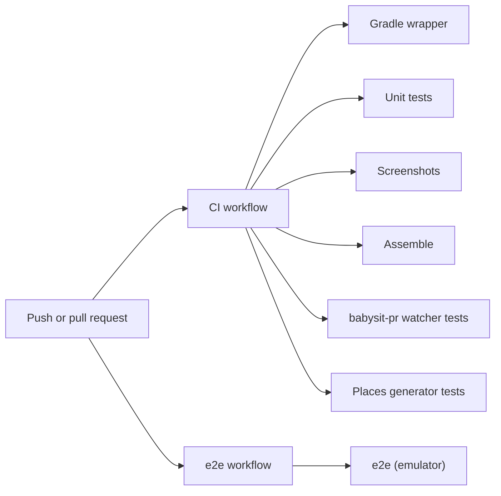
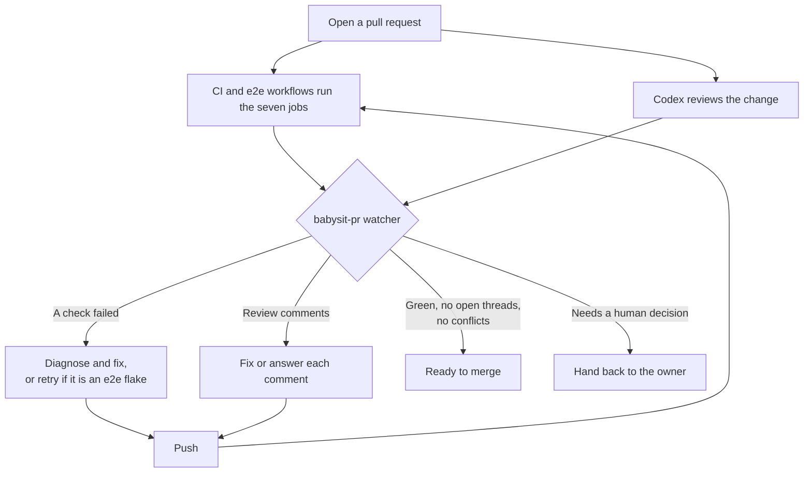

# Testing and CI

Clockblock uses test-first development with JVM tests, screenshot goldens and emulator end-to-end tests.
GitHub Actions runs the suites on each pull request. Codex reviews the change.

The sections below list test coverage, commands and pull request checks.

## Test layers

| Layer | Framework | Runs on | Command |
|---|---|---|---|
| Pure logic: planner, models, mappers, schedulers | JUnit 6 Jupiter, Kotest assertions, kotest-property | JVM | `./gradlew test` |
| Android and Compose: UI tests, ViewModels, repositories | JUnit 4 on Robolectric (run through the Vintage engine) | JVM | `./gradlew test` |
| Screenshots | Roborazzi on Robolectric | JVM | `./gradlew verifyRoborazziDebug` |
| End to end | Compose test and UiAutomator 2.4 | Emulator or device | `./gradlew :app:connectedPlayDebugAndroidTest` |

The screenshot tests are JUnit 4 tests too, so they also run in `./gradlew test`, without comparing images.
`verifyRoborazziDebug` runs the same tests and fails when an image differs from its golden.

The `:app` module has `play` and `oss` flavours. See [README](../README.md#build-and-test).
Unit and screenshot tests run on `play` only.
`DistributionManifestTest` requires `USE_EXACT_ALARM` in the oss manifest and excludes it from play.
The flavourless `testDebugUnitTest`, `recordRoborazziDebug`, `verifyRoborazziDebug` and `compareRoborazziDebug` names alias play tasks.
Root commands therefore include `:app`. Aliases reject `--tests`; filter the play task directly, such as `:app:recordRoborazziPlayDebug --tests '*ShellScreenshotTest*'`.

## Conventions

These rules come from [AGENTS.md](../AGENTS.md) and [CONTRIBUTING.md](../CONTRIBUTING.md).

- Write the failing test first, then the code.
- Pure logic uses JUnit Jupiter (`org.junit.jupiter.api.Test`) with Kotest matchers (`io.kotest.matchers.*`).
  Where an invariant exists, add a property test with `kotest-property`.
- Android and Compose tests use JUnit 4 with `@RunWith(RobolectricTestRunner::class)`,
  `@GraphicsMode(GraphicsMode.Mode.NATIVE)` and `@Config(sdk = [37])`, the app's minSdk.
- ViewModel tests use
  [`MainDispatcherRule`](../core/testing/src/main/kotlin/dev/sebastiano/clockblocker/opus/core/testing/MainDispatcherRule.kt)
  from `:core:testing` and Turbine for flows. `:core:testing` also has fakes such as
  [`FakeJetLagPlanner`](../core/testing/src/main/kotlin/dev/sebastiano/clockblocker/opus/core/testing/FakeJetLagPlanner.kt).
- Unit tests run with `user.timezone=UTC`, so a test never depends on the machine's zone. Tests that need a zone
  set it explicitly.
- Test forks run in parallel, using half the CPU cores.

## Screenshot tests

Screenshot tests call `compose.captureRoboImageInvalidated(...)` from `:core:testing` and write to `<module>/src/test/screenshots/`.
The helper redraws every view before capture. Robolectric 4.17 at SDK 37 can otherwise capture a blank, newly created Compose view.
Committed goldens make pixel changes visible in pull requests. The base class in `:core:designsystem`,
[`ScreenshotTest`](../core/designsystem/src/test/kotlin/dev/sebastiano/clockblocker/opus/core/designsystem/ScreenshotTest.kt),
can render a component in light or dark, in Night-safe or Opus mode, at a custom font scale, and on the 12-hour
or 24-hour clock. Goldens use reduced motion for stable images and readable still-state checks.
See [MOTION.md](../MOTION.md).

```sh
./gradlew :feature:plan:verifyRoborazziDebug   # compare one module with its goldens
./gradlew :feature:plan:recordRoborazziDebug   # re-record after an intended UI change
./gradlew verifyRoborazziDebug                 # compare every module
```

When a comparison fails, Roborazzi writes comparison images that show the old image, the new image and the
difference under `<module>/build/outputs/roborazzi/`. CI uploads that folder as the `screenshot-diffs` artefact.

## End-to-end tests

The e2e tests are in [`app/src/androidTest`](../app/src/androidTest/kotlin/dev/sebastiano/clockblocker/opus/e2e).
They drive the real app, with real DataStore files and real notifications.

| Test class | What it covers |
|---|---|
| `SmokeTest` | The app starts on the right first screen, and shows the navigation after onboarding |
| `FirstRunTest` | All onboarding steps (work-day and days-off sleep, the chronotype reveal and its "Doesn't sound like me" sheet), finished without the permission prompt ("Maybe later", or "Finish" when notifications are already allowed); skipping ahead and stepping back |
| `NotificationsTest` | "Allow notifications" on the Reminders card grants notifications through the system dialog, then Exact timing is offered only if it isn't allowed yet; the test reminder appears in the shade and opens the plan; the Now notification keeps its Remote Compose content in the shade, and its Done action logs the outcome |
| `TripsTest` | Creating a trip with the pickers and fixing a validation error; the demo trip; Done on the Now card logs the outcome |
| `EditorConfigChangesTest` | The trip editor keeps its input across rotation and a large font |
| `PlanInteractionsTest` | A timeline block opens the Why sheet and the toolbar jumps back to now; a light block's Why sheet shows the light response curve, and its "Later hour" action moves the readout; a timeline check-off circle logs Done, and Undo or unticking clears it; calendar export opens the file picker |
| `PlanTwoPaneTest` | In landscape, where the plan has two panes, the day strip marks the day the timeline is showing |
| `DeepLinkTest` | Every `clockblock://` link, including one sent to an already running app |
| `WidgetTest` | *Two clocks* shows the active trip and opens its plan; *Next up* with no trips opens the trip editor |
| `SettingsTest` | Dark theme repaints the app; replaying setup returns to Settings; one hidden extra |
| `BackupImportTest` | Importing a backup: Merge is the dialog's main action and keeps the trips already on the phone; Replace swaps them for the backup's. The system file picker is replaced by a stub that returns a prepared file |

[`ClockblockE2eTest`](../app/src/androidTest/kotlin/dev/sebastiano/clockblocker/opus/e2e/ClockblockE2eTest.kt) is the base
class. It provides a Compose test rule and a UiAutomator `UiDevice`. Tests check which screen is showing through
the navigation shell's route tags (for example `route_now`).

Each test resets app data without restarting the process.
[`AppDataReset`](../app/src/androidTest/kotlin/dev/sebastiano/clockblocker/opus/e2e/AppDataReset.kt) does this
because `pm clear` would stop test instrumentation.
It closes activities, resets repository DataStores through `AppGraph`, clears SharedPreferences and cancels notifications.
Runtime permissions remain granted between tests.

```sh
./gradlew :app:connectedPlayDebugAndroidTest   # needs a running emulator or a connected device
```

## Debug tools

Debug builds add **Settings → Debug → Debug tools**
([`DebugActivity`](../app/src/debug/kotlin/dev/sebastiano/clockblocker/opus/debug/DebugActivity.kt)). It runs the
Remote Compose notification probe (#49) and opens the widget gallery's pages, so you can try them on a phone
without adb. The probe posts the Now notification's Remote Compose documents on a demo plan, in four variants (the
real Now notification uses one of them, with its actions): a 48 dp collapsed row and an expanded view sized for the
shade, in colours that follow the system theme. Its results stay on screen when you switch the theme. Release
builds don't include it.

## CI

The `.github/workflows/ci.yml` workflow has six jobs. The separate `.github/workflows/e2e.yml` workflow runs the emulator suite.
Both run on pull requests, pushes to `main` and manual requests. New PR pushes cancel older active runs.
The separate emulator workflow lets babysit-pr retry emulator failures without repeating all other CI jobs.



All seven jobs run in parallel. Each one reports its own check on the pull request.

| Job | Workflow | What it runs | Artefacts |
|---|---|---|---|
| Gradle wrapper | CI | Validates `gradle-wrapper.jar` against the official checksums | none |
| Unit tests | CI | `./gradlew test --continue` | `unit-test-reports`, on failure |
| Screenshots | CI | `./gradlew verifyRoborazziDebug --continue` | `screenshot-diffs`, on failure |
| Assemble | CI | `./gradlew :app:assemblePlayDebug :app:assemblePlayRelease :app:assembleOssDebug :app:assembleOssRelease :app:assemblePlayDebugAndroidTest` | The play and oss debug APKs (`clockblock-debug`, `clockblock-oss-debug`), kept 14 days |
| babysit-pr watcher tests | CI | Python 3.12 `unittest` over `.agents/skills/babysit-pr/scripts` | none |
| Places generator tests | CI | Python 3.12 `unittest` over `tools/places`: the city-name rules and the committed `places.tsv` | none |
| e2e (emulator) | e2e | [`run-e2e.sh`](../.github/scripts/run-e2e.sh) runs `./gradlew :app:connectedPlayDebugAndroidTest` on an API 37 Google APIs x86_64 emulator (canary emulator channel, Pixel 7 profile, 4 GB RAM, 8 GB disk, animations off, KVM), with three-button navigation, once the package manager answers and the user is unlocked steadily, and retries once if the APKs fail to install. Then [`verify-e2e-ran.sh`](../.github/scripts/verify-e2e-ran.sh) fails the job if an APK didn't install or no test ran, because the test runner can end successfully without running anything. **For now both are non-blocking** ([#122](https://github.com/rock3r/clockblock/issues/122): the emulator keeps restarting system_server): a failed or empty run adds a warning to the job instead of failing it | `e2e-reports` with the Gradle log and the device logcat, always |

Every Gradle job sets up JDK 21 and the Android SDK through the local composite action
`.github/actions/setup-android-build`. It installs `platforms;android-37.1`, the build tools and the platform tools
with the runner's own `sdkmanager`.

The Screenshots job runs on macOS, matching the system used to record goldens. Other jobs run on Linux.
Linux renders the dial's hatched arcs with different anti-aliasing, which fails pixel-exact comparisons.
Matching operating systems avoids those differences while retaining checks for small visual regressions.

## Pull requests and review

All changes reach `main` through pull requests. Before you push, run the same local gate that the PR tooling
expects:

```sh
./gradlew test :app:assemblePlayDebug :app:assembleOssDebug verifyRoborazziDebug
```



The watcher reports failed checks and review comments after a pull request opens.
A contributor or coding agent fixes failures, answers findings and pushes updates.
The watcher stops when the PR meets its merge requirements or needs an owner decision.

The watcher is part of the babysit-pr skill (v2.2.1), vendored in `.agents/skills/babysit-pr/` from
[rock3r/babysit-pr-skill](https://github.com/rock3r/babysit-pr-skill). Its `SKILL.md` explains how to use it. The
project settings are in its `config.json`:

| Setting | Value | Meaning |
|---|---|---|
| `local_gate` | `./gradlew test :app:assemblePlayDebug :app:assembleOssDebug verifyRoborazziDebug` | Run this before every push |
| `required_checks` | Gradle wrapper, Unit tests, Screenshots, Assemble, babysit-pr watcher tests | These must pass before the PR counts as ready |
| `retry_eligible_workflow_keywords` | `e2e` | A failed run of the e2e workflow may be retried without a diagnosis, because emulators can be flaky. Any other failure needs a diagnosis first. |
| `review_bot_login_keywords` | `codex` | Comments from the Codex bot count as review items |
| `codex.required` | `false` | If Codex hasn't started a review 10 minutes after the checks finish, the PR doesn't wait for it |

```sh
python3 .agents/skills/babysit-pr/scripts/gh_pr_watch.py --pr auto --once      # wait until something needs attention
python3 .agents/skills/babysit-pr/scripts/gh_pr_watch.py --pr auto --snapshot  # current state, no waiting
```

Authenticate `gh` before running the watcher.
Update the vendored skill only through `sync.py`. Its `VERSION` file records the source in `.agents/skills/babysit-pr/`.
