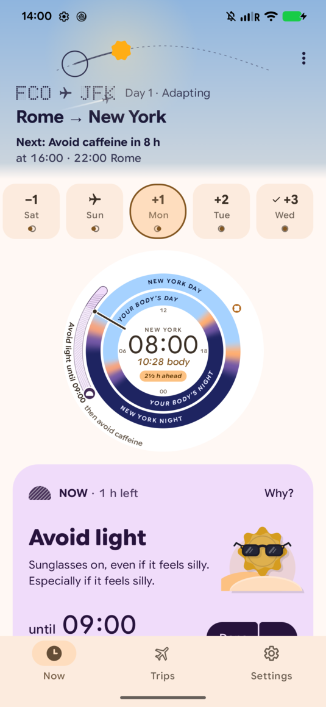

# Clockblock user guide

Clockblock plans light, sleep and caffeine times to help you adjust after a flight.
Enter your home time zone, usual sleep times and flights. The app builds a schedule on your phone.
Clockblock works offline and requires no account.

Travellers can use Clockblock without a background in sleep research or Android development.

  

The plan dial compares local time with your estimated body clock time.
The card below gives the current advice and its end time.

## Pages

| Page | What you'll learn |
|---|---|
| [Getting started](getting-started.md) | What the app needs, and the six setup questions |
| [Planning a trip](planning-a-trip.md) | Adding flights, connections, return trips and delays |
| [Following your plan](following-your-plan.md) | Reading the dial, the Now card and the timeline, and what to do when you miss something |
| [Widgets and notifications](widgets-and-notifications.md) | Reminders, the ongoing notification, and the home-screen widgets |
| [Settings and your data](settings-and-your-data.md) | Changing your profile, reminders and appearance; backups and calendar export |
| [Questions and answers](faq.md) | Short answers to common questions |

## Before you start

Clockblock gives healthy adults general information based on published research. It cannot give medical advice.
Flight crew must not use it for duty schedules.
If you have a health condition, are pregnant, or take medication, consult a doctor before changing your sleep or taking melatonin.
