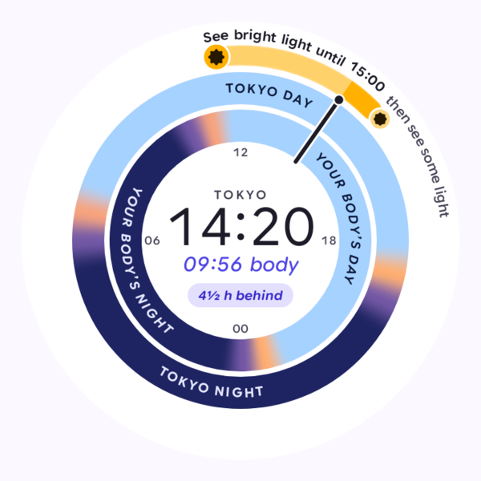
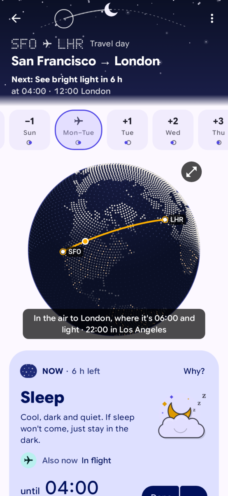
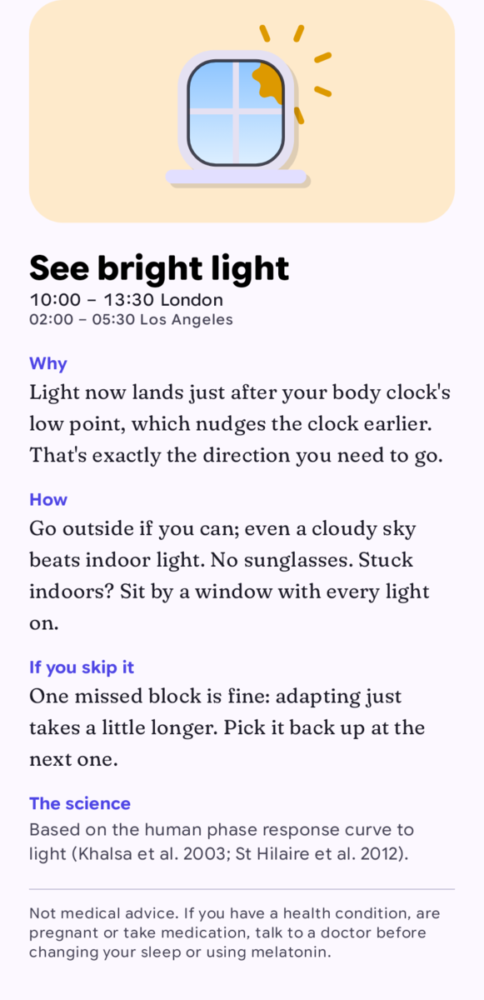
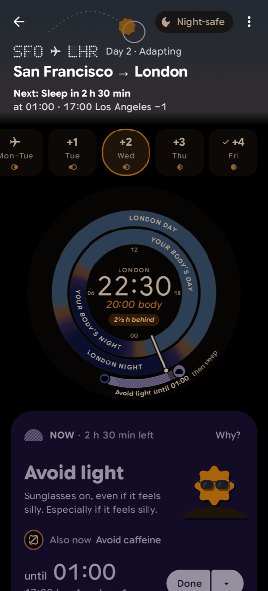
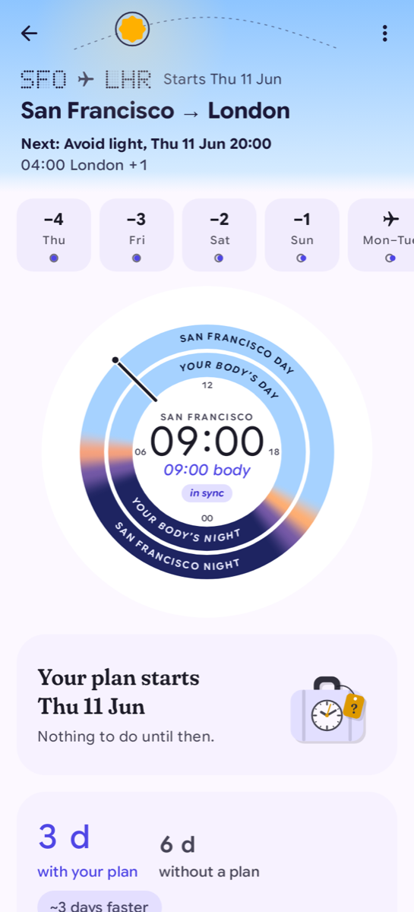
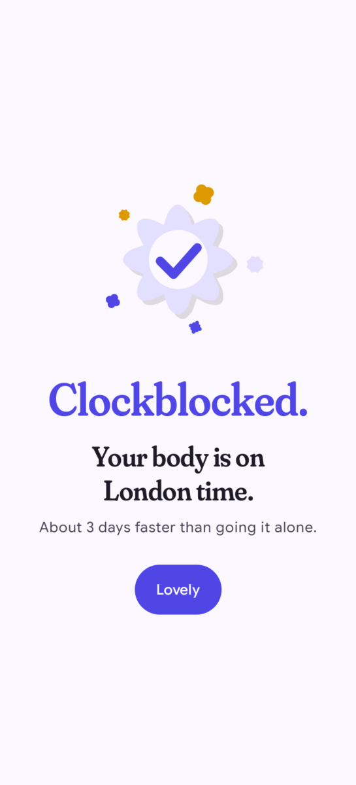

# Following your plan

Your plan schedules light, sleep, naps and caffeine in timed blocks.
The plan screen shows the current advice, its end time and the next block.
Tap **Why?** for a block's reason and research sources.

## Opening the plan

- The **Now** tab shows the plan for the trip that matters right now: the one in progress, or else the next
  upcoming one. When all your trips are in the past, **Now** offers to plan your next trip or open **Trips** to
  look back at past plans.
- On the **Trips** tab, tap any upcoming or past trip card to open its plan. On a phone it opens full screen; use
  the back button in the top bar (or the system back gesture) to return to **Trips**. On a tablet in portrait, it
  opens the same way but the navigation rail stays at the side.
- On a tablet in landscape, or any other wide window (an unfolded foldable held sideways, a large desktop window),
  the plan opens beside your trips instead, and the trip you opened is outlined in the list. Tap another trip to
  switch, and go back (or tap **Trips** again) to close the plan. Drag the handle between the two to give the list
  or the plan more room.

## The plan screen

The screen has seven main parts, in this order:

1. **The header** shows the airport codes and the trip, the day of the plan ("Day 2 · Adapting" or "Pre-trip day −1";
   on a small phone it also says how far off your body clock is, when the dial leaves out its pill) and the next block
   to start ("Next: Avoid caffeine in 1 h 20 min" with the time in both zones, or its date and time when it's more than
   a day away). "Next" always counts from now, even while you look at another day or drag the dial. Its sky and its sun or moon show your body's time of day, with stars when your body is at night. A
   faint ring on the sun's dotted path marks where the sun is by the clock, and a line joins the two when your body is
   half an hour or more off.
2. **The day strip** has one pill per day of the plan (see below).
3. **The dial** compares two clocks (see below).
4. **The Now card** says what to do right now.
5. **Up next** shows the following block.
6. **How you're adapting** compares the plan with doing nothing (see below).
7. **Your plan** is the full timeline, day by day.

On a small phone, the day strip moves below the Now card so that **Done** stays on screen without scrolling.

### The day strip

Each day button counts from the flight date: "−2", "−1", a plane for travel, then "+1", "+2" and later days.
A tick marks estimated adjustment. Weekday labels can span two days for overnight flights, such as "Mon–Tue".
The hollow dot represents local time; the filled dot represents your body clock.
Their distance shows the estimated time difference. They overlap when the clocks match. An outline marks today.

Tap a day button to preview that day at the current time of day.
The header, dial and Now card update. The card names the preview, such as "Day 3 at 11:00".
Tap today's button or the toolbar's **Now** to return.
On tablets, selecting a day also scrolls the timeline there.
Scrolling the timeline manually adds a bar below the visible day's button. This leaves the selected day unchanged.

### The dial

The outer dial ring shows local daylight, darkness, dawn and dusk.
The inner ring shows the same sky shifted by your estimated body clock difference.
The distance between the night sections shows that difference. The rings align as your estimated body clock adjusts.

The large central number shows local time. The smaller italic number shows estimated body clock time, such as "09:56 body".
The label below gives the difference: "4½ h behind", "2 h ahead" or "in sync".

The needle points at the time shown. Outside the rings, an arc shows the block under the needle, with its name and
when it ends ("See bright light until 15:00") and what comes next. When nothing is on, it shows the next block and
when it starts. This text grows with your font size, up to a point, so it stays readable with larger text. On a
small phone, the dial is simpler: the rings say only the city and "Body", and the Now card below gives the details.

The dial follows the clock on the wall. On the night the clocks change, a block from 01:00 to 04:00 covers three
hours of the dial, even though only two hours pass when the clocks go forward.

To look ahead, drag the needle around the dial. The Now card changes to show what you'd be doing "At 18:30",
for example. Let go and the needle returns to now (or to the day you picked in the day strip). You can also tap the
centre to return. With TalkBack, the dial offers the actions **Next block**, **Previous block** and **Back to
now**.

While you drag, the timeline highlights the block under the needle. On a tablet, if that block is off screen, the
timeline also scrolls to it.

#### The world behind the dial

Pinch out on the dial with two fingers to zoom out from your day to the world. The dial shrinks onto the spot on
Earth where you are while the globe pulls back to show your whole trip; it follows your fingers, so you can stop half
way and change your mind. The globe shows the route, a dot where you are at the dial's time (now, or the day you
picked in the day strip), and the night side of the Earth at that time. A line on the globe says the time where you
are and whether it's dark, with the time at the other end of your trip, for example "It's 03:10 and dark in Tokyo ·
19:10 in Lisbon", or where you're flying to when you're in the air.

Drag the globe to turn it; flick it and it coasts to a stop. Double-tap it, or tap the re-centre button, to frame
your trip again. Tap a flight or an airport to see its name. The full-screen button in the corner opens the globe
over the whole plan, where you can also zoom in with two fingers or the + and − buttons. Pinch in on the globe, or go
back, to zoom back in to the dial. With TalkBack, the dial offers **Show the world**; the globe reads out your trip
and offers **Back to the dial**, **Show the globe full screen**, an action per flight, and actions to turn and
re-centre it. With Reduce motion or Remove animations on, the dial and the globe swap in place instead of zooming.

### The Now card

The card shows:

- "NOW" and how much time is left in the block.
- What to do, in large text (for example **Sleep** or **Avoid caffeine**), and a short tip.
- Other blocks that are also active, each on its own row with its symbol, "Also now" and its name, such as
  **Also now** Avoid caffeine.
- When it ends: "until 15:00", with the same moment in your other time zone next to it ("07:00 Los Angeles").

When you've done it, tap **Done**, at the bottom right of the card. The small arrow next to Done offers **Skipped**, **Can't do this** and
**Snooze 15 min**. After Done, Skipped or Can't do this, a message appears at the bottom with **Undo**. Snooze
has no Undo: reminders stay quiet for 15 minutes, then this one comes back if its block is still going.

### How you're adapting

This card puts two estimates side by side: how many days adapting should take with your plan, and without one. When
the plan is faster, a pill says by how much, for example "~3 days faster". Below that are how far you've come
("59% adapted · about 2 days to go") and a small chart:

- The **solid line** is how many hours your body clock is off destination time, day by day, if you follow the plan.
  It often starts dropping before you fly, thanks to the pre-trip days.
- The **dashed line** is a rough guide to doing nothing: your body stays on home time until you land, then catches up
  by the time the model expects.
- The vertical line marks when you **arrive**, and the dot shows the moment on screen. It moves when you pick a day
  in the day strip.

#### Why some eastward plans shift later

Large eastward trips can use a delay plan.
For example, Los Angeles to Dubai can require a 13-hour delay to reach the same clock time as an 11-hour advance.
Destination morning light can fall before your body's estimated low point and delay your clock.
Many people also adjust more easily to later times. The card explains this direction choice without promising faster adjustment.
Researchers still debate the choice. See [the science](../docs/science.md).

### The timeline

The timeline lists every day of the plan: pre-trip days, the travel day, the days after you land, and the day you're
adapted. Each block shows its local time and how long it lasts on one line ("22:45 – 01:00 · 2 h 15 min") and,
underneath, the time at the other end of the trip. With large text, the duration moves to its own line. Earlier days
are folded away; tap **Show N earlier days** to see them. Tap any block to read why it's there.

The timeline uses these visual markers:

- The block happening now sits in an outlined card, with its start time in colour, a **Now** label and a line
  across its capsule at the current time. Blocks that are over are greyed back a little; blocks still to come are
  in full colour.
- Each block's capsule has its advice colour, a coloured edge and a pattern (stripes for Avoid light, stars for
  Sleep, dots for naps), so you can tell them apart even if you can't tell the colours apart.

- A short block that falls inside a longer one, such as **Caffeine OK** during **See bright light**, is shown as a
  small chip inside the longer block. Tap the chip to read about it.
- Blocks that happen on board are marked **In flight**.
- Where the times switch from one time zone to the other, a divider says so, for example "Switching to London
  time · UTC+1 · +8 h from Los Angeles".
- Blocks that have started have a circle on the right. Tap it to mark the block done, the same as **Done** on the
  Now card: a message appears with **Undo**. Tap a filled circle to clear it. Flights and blocks that haven't
  started yet have no circle.

The toolbar at the bottom jumps to **Now**, lets you pick any day of the plan (**Day**), or opens **Why?** for the
current block. It appears once the Now card has scrolled away. While you scroll on through the plan it slides out
of the way, and it comes back when you scroll back up or reach the end of the plan.

## Why is this in my plan?

Tap **Why?** on the Now card or a timeline block to open its explanation.
The sheet contains four sections:

- **Why**: what this block does for your body clock.
- **How**: practical tips.
- **If you skip it**: what happens if you miss it. Usually, one missed block is fine.
- **The science**: the research it's based on.

Light blocks (**See bright light**, **See some light** and **Avoid light**) also show a **light response curve**
under **Why**. Drag the sun along it to see whether light at each hour moves your body clock earlier or later, and
how strongly. The band marked "this block" is the block you opened. The curve is a simplified drawing of what the
research found, and everyone's body responds a little differently. You can try the same curve in **About**, under
**How it works**. With TalkBack, open the Actions menu on the curve for **Earlier hour**, **Later hour** and **Reset
to this block**.

## What the blocks mean

Every block pairs its icon with a text label.

| Label | What to do |
|---|---|
| See bright light | Get outside if you can. Even a cloudy sky beats indoor light. A window seat counts. |
| See some light | Stay out of the dark. Lights on, no sunglasses. |
| Avoid light | Sunglasses on, or stay somewhere dim. |
| Sleep | Cool, dark and quiet. If sleep won't come, just stay in the dark. |
| Nap | Keep it short and set an alarm. |
| Nap if you're tired | Only if you need it. Twenty minutes is plenty. |
| Caffeine OK | Coffee or tea can help now. Little and often beats one big cup. |
| Avoid caffeine | It would still be in your body at bedtime. |
| Take melatonin | Only if you turned melatonin on. No driving afterwards. |
| Peak fatigue | Your body's low point. Take extra care, especially when driving. |
| Flight | Follow the light and sleep blocks on board. |

## When you miss something

Tap **Skipped** or **Can't do this**, then follow the next block.
Skipping can delay adjustment. Clockblock records the check-in without changing the plan.

If flights change, edit the trip or use [I'm delayed](planning-a-trip.md#when-your-flight-is-delayed).
Clockblock rebuilds the plan using the new flight times.

## Night-safe

A bright screen adds light during an avoidance window.
Night-safe darkens and dims the plan screen during sleep, light avoidance, or body night without planned light.
The screen shows a **Night-safe** label. Disable **Night-safe automatically** in Settings to turn this feature off.

## Other things you may see

When the plan has no current advice, a message replaces the Now card.
This example shows a plan that starts in a few days.

| Message | What it means |
|---|---|
| Your plan starts … | The plan hasn't started yet. It shows when the plan begins and how long adapting should take; the first block is in the header above. |
| Free time | Nothing to do right now. Live your life. What's next is in the header. While you look at another day or drag the dial, the card also says what comes next from that moment. |
| Short trip: staying on home time | You're back before your body could settle, so the plan keeps your body on home time. |
| No jet lag expected | Home and destination keep nearly the same hours. Keep your usual sleep and get some morning daylight. |
| Trip complete | The plan is over. It shows how many blocks you did, skipped or couldn't do. |

### Clockblocked

Clockblock shows a celebration once when the plan estimates that your body clock has adjusted.
It also shows the estimated time saved by following the plan.

## The plan menu

The three-dot menu at the top of the plan has:

- **Edit trip**
- **Create return trip**
- **Export to calendar**: saves the plan as a calendar file that you can open in your calendar app.
- **Share summary**: shares a short text summary of the plan.

Next: [Widgets and notifications](widgets-and-notifications.md).
