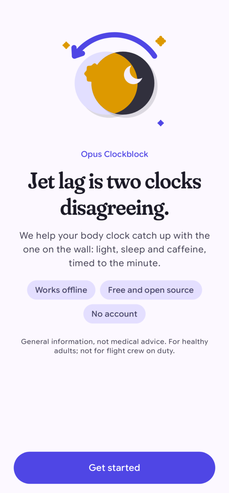
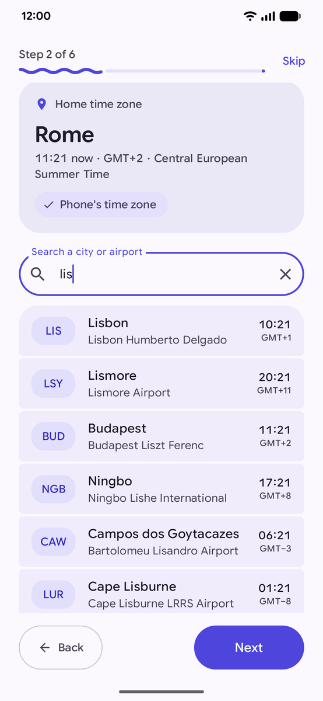
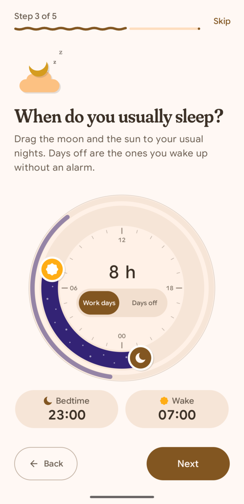
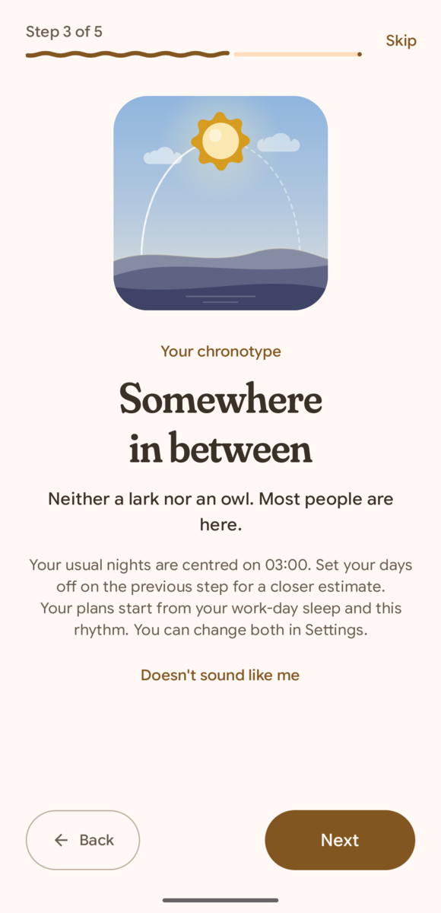
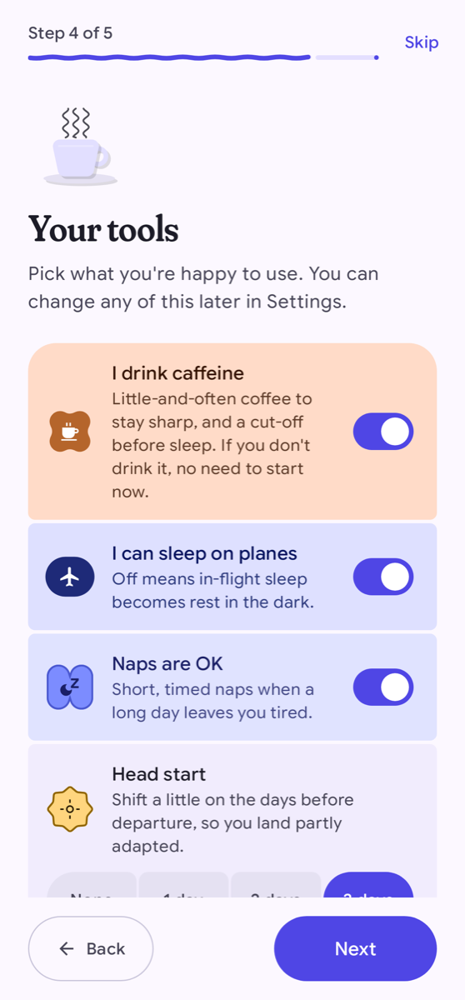
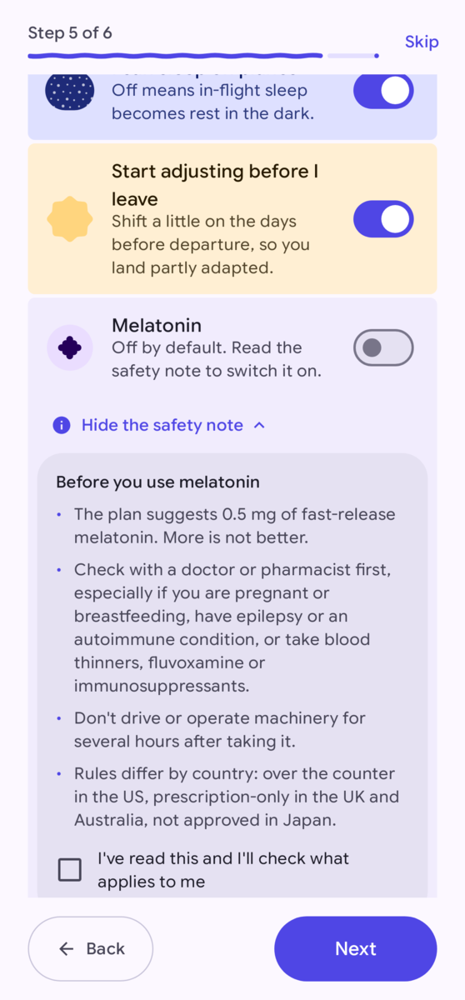
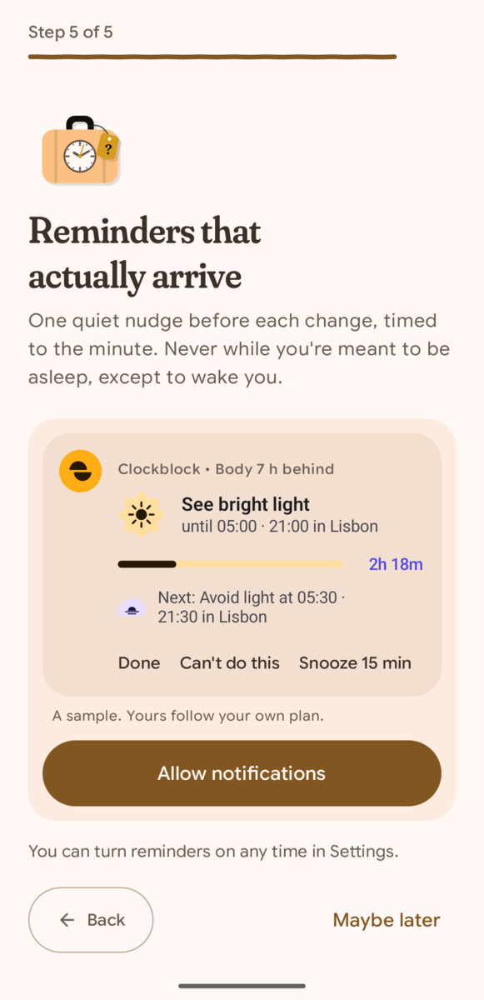

# Getting started

The first time you open Clockblock, it asks five short questions. Your answers set where your body clock
starts and how hard the plan pushes. It takes about two minutes, and you can change every answer later in
Settings.

## What you need

- An Android phone or tablet with Android 17 or later.
- No account and no internet connection. The app works the same in flight mode.

Clockblock isn't in an app store yet. To install it, build it from the source code (see the
[project README](../README.md#build-and-test)).

## The five setup steps

From step 2 on, the top shows "Step N of 5". Use **Back** to go to the previous step. **Skip** (not on the last
step) keeps your answers so far and the defaults for the rest, and jumps to the last step.

### 1. Welcome

The first screen explains the idea: jet lag is two clocks disagreeing, the one on the wall and the one in your
body. Tap **Get started**.

### 2. Where's home?

The app picks your phone's time zone and marks it "Phone's time zone". If home is somewhere else, search for a
city or a three-letter airport code and pick the right place. You can change it later in Settings.

Each plan assumes your body clock starts in the time zone of the trip's first departure airport. When a trip
leaves from a city on a different time from home, the trip editor asks where your body clock is when you leave:
that city, or still on home time. See [Starting away from home](planning-a-trip.md#starting-away-from-home).

### 3. When do you usually sleep?

Drag the moon to your usual bedtime and the sun to your usual wake-up time. The dial holds two schedules:

- **Work days**: your usual nights before work or other early commitments. Plans start from these.
- **Days off**: the nights you wake up without an alarm.

Switch between them with the **Work days** and **Days off** buttons beside the dial, or tap the thin outer ring: it
shows the other schedule. With a very large font or a narrow screen the buttons move above the dial, and on a phone
on its side they sit beside it with the Bedtime and Wake buttons, so their words always fit. Days off start as a copy
of work days ("Same as work days for now"); move a Days off handle to set them on their own. If your
nights are the same every day, leave Days off alone.

The middle of the dial shows how long you sleep, for example 8h 30m. A very short or very long night gets a note
under the Bedtime and Wake buttons.

Under the dial, the **Bedtime** and **Wake** buttons show the times of the schedule you're editing and follow the
dial as you drag. To enter an exact time instead, tap either one: a time picker opens. Its keyboard button lets you
type the time. If the time you pick would make the night shorter than an hour, the other end moves to keep one hour
of sleep.

#### Your chronotype

When you tap **Next**, the app works out your chronotype from those two schedules: Early bird, Morning person,
Somewhere in between, Evening person or Night owl. It uses the middle of your nights off, allowing for catch-up sleep
after the working week (the Munich ChronoType Questionnaire's method). If you left Days off as a copy of work days,
the screen says it used your usual nights and suggests setting your days off for a closer estimate.

If it doesn't fit, tap **Doesn't sound like me** and pick another. The one your sleep suggests is marked. The screen
then says **Your pick**, and changing your nights later doesn't override it.

### 4. Your tools

Pick what you're happy to use. Each row has the shape and icon of the advice it adds to your plan. When a switch is
on, its row takes that advice's colour.

| Setting | What it changes |
|---|---|
| I drink caffeine | Suggests little-and-often coffee to stay sharp, and a cut-off before sleep. If you don't drink coffee, turn it off. |
| I can sleep on planes | When off, sleep on the plane becomes "rest in the dark" instead. |
| Naps are OK | Adds optional short naps ("Nap if you're tired") on days you might be tired. Turn it off if you'd rather not nap. One nap stays even then: after a day that keeps you awake at least an hour longer than usual, the plan still suggests it, because that one matters. |
| Head start | Shifts your clock a little on the days before departure (**None**, **1 day**, **2 days** or **3 days**), so you land partly adapted. |
| I use melatonin | Off by default. See below. |

Then choose how hard the plan should push:

- **Gentle**: smaller daily shifts and fewer early starts. It takes a little longer.
- **Balanced**: the pace the research supports. A good default for most trips.
- **Max**: the Balanced pace, plus a smarter choice of direction. For eastward shifts of 8 to 12 hours, it
  simulates both shifting earlier and shifting later. If one adapts you more than a day faster, it picks that one.
  Otherwise it keeps the usual direction.

#### Melatonin

Melatonin suggestions stay off until you read the safety note and tick **I've read this and I'll check what
applies to me**. The plan only suggests a small dose (0.5 mg of fast-release melatonin), and only to shift your
clock earlier. Melatonin is a medicine in many countries. Check with a doctor or pharmacist first.

### 5. Reminders that actually arrive

The app can remind you just before each change in your plan. It never sends a reminder while you're meant to be
asleep, except the one that wakes you.

The card shows a sample of the reminder that stays in your notification shade while a plan runs. Tap **Allow
notifications** under it to let the app show reminders. Android asks you to confirm.

Once notifications are allowed, the bottom button becomes **Finish**. If your phone still needs it, an **Exact
timing** row then appears: it lets reminders arrive on the minute. Without it, Android may deliver them up to
10 minutes late, and while the phone is idle (Doze) usually up to about an hour late. Android doesn't promise a
limit. Tap **Open settings** to allow it, or skip it.

If you installed the app from outside Google Play, exact timing is allowed when you install it, so the row never
appears.

**Maybe later** finishes setup without asking. If you said no when Android asked, the card offers **Open settings**
instead, and the bottom button is **Finish**. You can grant the permissions any time from Settings → **What Android
allows**.

## What's next

After setup, the app opens the Trips screen. [Plan your first trip](planning-a-trip.md), or tap **Try a demo
trip** to explore with an example.
