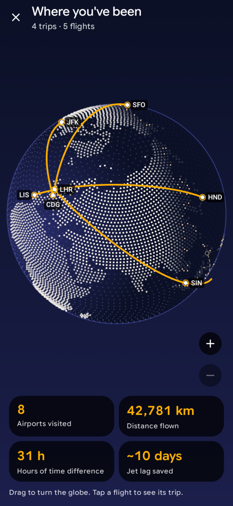

# Planning a trip

A trip contains one or more flights. Enter each flight's local departure and arrival times to build a plan.
You can edit the trip at any time. Clockblock then rebuilds its plan.

## The Trips screen

With no trips, the screen says "Where to next?". Tap **Plan a trip** to add your own, or **Try a demo trip** to
see an example plan for a flight from San Francisco to London a few days from now.

The **Now** tab shows your current or next trip. **Trips** shows later **Upcoming** trips and **Past trips**.
Each card shows airport codes, a route arc, and the cities or trip title.
It lists flight times and stops together. Each time uses the airport's local zone.
The card also shows the time difference, plan start or end, and estimated adjustment time.
Completed trips show their result: "Adapted", "Stayed on home time", or a percentage if another trip interrupted adjustment.

Past trips appear at the bottom in muted colours.
A trip stays on **Now** through the plan's final sleep block before moving to **Past trips**.
The tabs show each trip in exactly one place.

Tap **Past trips** to open a full-screen globe of previous routes.
It lists total distance, airports visited, summed flight time differences and estimated days of jet lag saved.
Drag to turn the globe or pinch to zoom. Tap a flight, then **Open trip**, to open its plan.
Use the close button or Back to close the globe.

During a trip, the sky behind the **Trips** title follows your body clock, and the subtitle shows your body clock
time.

Tap **New trip** in the corner to add a trip.
Its menu offers **New trip**, **Return from** your current or most recent destination, and **Try a demo trip**.
In short windows, a **+** button in the top bar replaces the corner button to avoid covering cards.

 

## Adding flights

Each flight card resembles a ticket. It shows airport codes at the top, departure and arrival below, and flight duration at the bottom.

Under each code, the card shows the city and its UTC offset at flight time.
It also names the airport when that differs from the city, such as Heathrow or Gatwick.

1. Tap **FROM** on the ticket. A search sheet opens: type a city, an airport name or a three-letter code (for
   example LIS) and pick the airport. The search works offline. Before you type, the sheet offers a few popular
   airports. Each result shows the city with its country's flag, the airport name and country underneath, the
   airport's current local time (with a sun or moon for day or night) and its UTC offset. Picking your home time
   zone uses the same rows.
2. Once **From** is picked, the sheet asks for **To** straight away. Picked the airports the wrong way round? Tap
   the swap button between them. To change an airport, tap its code again.
3. Tap the departure date and time. Use the **local time at the departure airport**, as printed on your ticket.
   The label reminds you: "Departs · local time in Lisbon".
4. Check the arrival date and time, in the **local time at the arrival airport**. Once both airports and the
   departure are set, the app fills in an estimate from the flight distance, marked "Estimated from the flight
   distance". Change it to the time on your ticket. Once you've set the arrival yourself, the app leaves it alone.
   When the flight lands on another calendar day, a red **+1 day** (or **−1 day**, **+2 days**) sits next to the
   arrival.
5. The bottom of the ticket shows the time in the air ("14 h 25 m in the air"). Add the flight number there if you
   like. It's optional and only used as a label.
6. If you change planes, tap **Add connecting flight** and fill in the next ticket. With more than one flight, each
   ticket gets a heading (**Flight 1**, **Flight 2**) and a button to remove it.
7. Flying back? Turn on **Return flight** (see [Return trips](#return-trips)).
8. Tap **Build my plan** at the bottom. Until the trip is complete, the button is greyed out and the line above it
   says what's missing.

The app works out the time difference and the flight duration for you, including daylight-saving changes.

After you complete the flights, **Your shift** shows the time difference and direction, such as "+9 h east".
It compares estimated adjustment times with and without the plan. The estimates update as you edit.
If Clockblock cannot build a plan, it reports the problem. Check the flight dates and times.

 

Once a flight has both airports, **Your shift** shows its route on a globe.
Arcs show the shortest paths across Earth; dots mark airports. Shading shows the current night side.
For connecting flights, the globe faces the flight you are editing and highlights its arc.
Tap another arc to scroll to that flight's card. Faint dashes show flights on the globe's far side.

Tap anywhere else on the globe to see it full screen. The full-screen globe labels each airport with its code. Drag
it to turn it, pinch or use the + and − buttons to zoom, and double-tap to frame your route again. Tap a flight there
to make it the ticket you're editing and see its name, then **Go to ticket** to close the globe and scroll to that
ticket. Close it with the close button or go back. With TalkBack, the globe reads out the trip, for example "Lisbon
to Tokyo via Doha, 9 hours east". With more than one flight it also offers an action per flight, such as **Go to
flight 2: Doha to Tokyo**, and the full-screen globe offers actions to turn, zoom and re-centre it.

If you stay at a stop for three days or more, the plan treats that stop as a destination of its own and adapts
you to it before the next flight.

### When something looks wrong

The editor checks flights as you enter them.
**Fix this** blocks plan creation. **Check this** flags a likely mistake. **Note** gives information without blocking the plan.
Some messages offer a correction button.
For example, an overnight flight with the wrong arrival date can show "Lands before it takes off" and **Arrives next day?**.

## Trip details

Below the flights, **Trip details** has these settings:

- **Title**: named after your route. Tap **Rename** to give the trip a name of your own.
- **Body clock**: how the plan treats your body clock.
- **Body clock when you leave**: only shown when the trip leaves from a city on a different time from home. See
  [Starting away from home](#starting-away-from-home).

| Choice | What happens |
|---|---|
| Auto | Adapts you to your destination, unless you fly back within 72 hours. Then you stay on home time. |
| Adapt | Moves your body clock to destination time, even for a short stay. |
| Home time | Keeps your body clock on the time it starts on. Best for quick trips. |

In the plan, "home time" means the time your body clock is on when you leave: the first departure airport's time,
unless **Home** is picked under **Body clock when you leave**.

If every time zone change on the trip is under two hours, Auto and Adapt don't make a body clock plan: you only
get flight advice and a few nights of sleep times.

For short trips, keeping your starting body clock time can reduce the adjustment needed after you return.

### Starting away from home

Plans use your estimated body clock time at departure. The default starting zone is the departure city.
If its time differs from Settings → Home time zone, **Trip details** shows **Body clock when you leave**.

| Choice | When to pick it |
|---|---|
| Departure city | You live there, or you've been there long enough to get over jet lag. |
| Home (your home city) | You only just got to the departure city, and your body is still on home time. |

For example, if you live in Los Angeles, flew to New York two days ago and fly on to Paris tomorrow, pick **Home**:
the plan then shifts you from Los Angeles time to Paris time.

For new trips ending on your home time, Clockblock initially selects **Home**.
This assumes your body clock remains near home time after a short stay away.
For other trips, it selects **Departure city**. Change the choice if your body has adjusted differently.
After a manual choice, flight edits keep that selection. Saving also keeps the selected starting zone.

A trip that leaves from home doesn't show this choice. If it's a round trip, turn on **Return flight** and **Auto**
keeps you on home time when you're back within 72 hours.

## Return trips

Enable **Return flight** below the flights to add a return while creating a trip.
When disabled, the switch shows "One way / not sure yet".
Clockblock suggests a return one week after arrival, at your outbound departure time of day.
Enter your ticket's date and time in the final destination's local zone. Clockblock uses this to detect short trips.

**Build my plan** also saves a separate return trip with the route reversed and outbound flight times copied.
Use **Edit** to check those times against your return ticket.
If the return leaves before outbound arrival, Clockblock blocks saving until you correct the date.

Editing an existing return updates that trip without creating a duplicate.
Changing its date or time keeps its flight durations, connections and flight numbers.
Turning **Return flight** off keeps the saved return unless you tick **Delete the return trip too**.
Turning it on again reconnects the same return at its saved date.
Editing the return trip directly also updates the outbound trip's return date.

You can also open a trip's menu (the three dots on its card) and choose **Create return trip**, or tap **New
trip** in the corner and then **Return from** the destination. The app reverses the route and suggests times.
Check them against your ticket before you build the plan.

Either way, when the return flies you home, its body clock starts on home time (see
[Starting away from home](#starting-away-from-home)).

## Changing a trip

Tap a trip card to open its plan. (With TalkBack, "Open plan" is also offered as an action on the card.) The
three-dot menu on the card has:

- **Edit**: change flights, times or trip details.
- **Duplicate**: copy the trip, for example for a similar trip later.
- **Create return trip**
- **Delete**: removes the trip. Tap **Undo** in the message at the bottom if you change your mind.

## When your flight is delayed

From 48 hours before departure until you land, the **Edit trip** screen shows an **I'm delayed** card.

1. Pick the flight that's late (on a trip with connections, each flight has its own chip).
2. Tap how late it is: **+30 m**, **+1 h**, **+2 h**, **+3 h**, or **Custom** to type the minutes.
3. Tap **Save changes**.

Clockblock moves the flight later and rebuilds the plan using the updated times.

Next: [Following your plan](following-your-plan.md).
