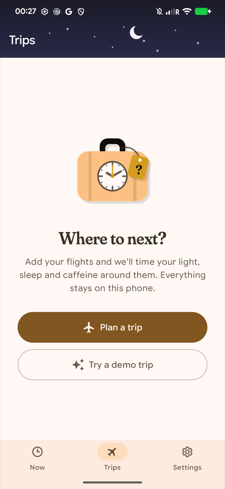
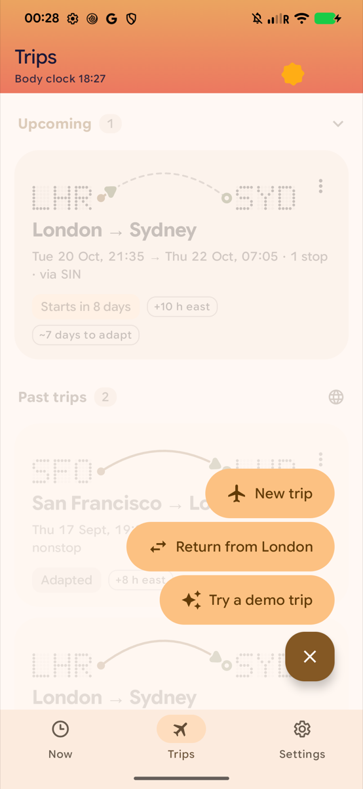
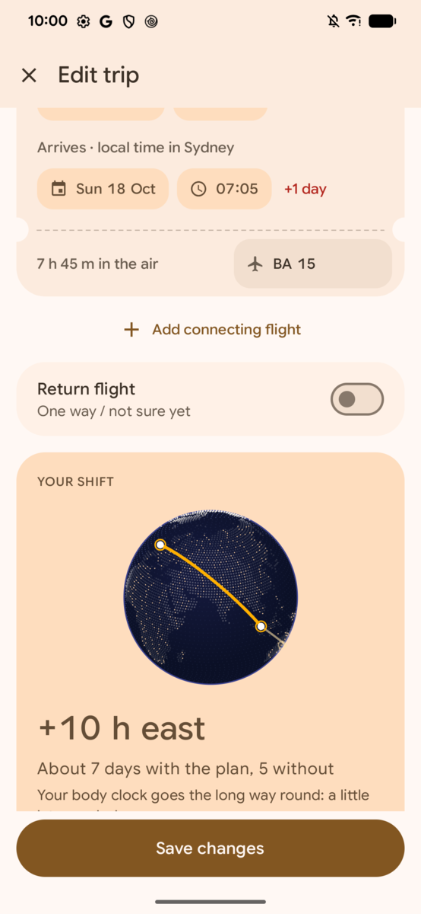
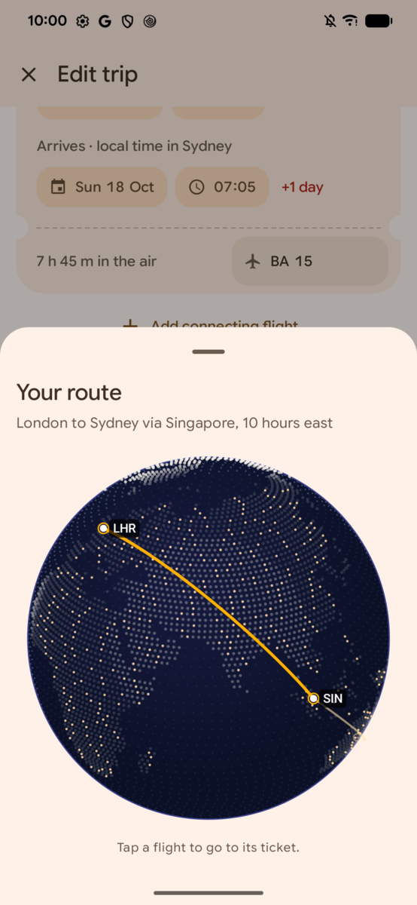
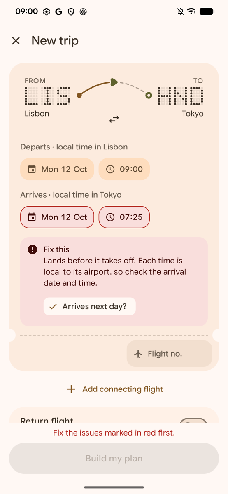
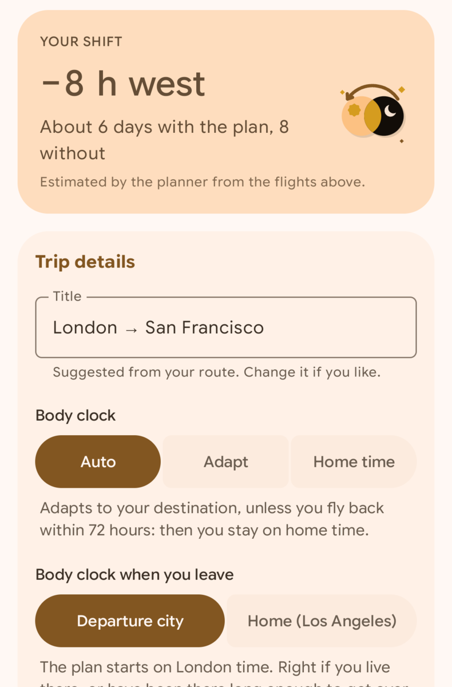
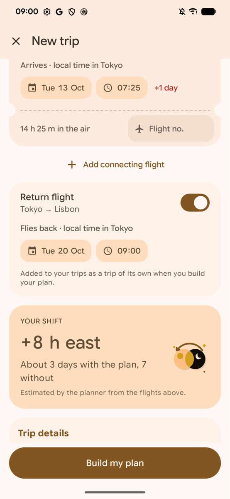
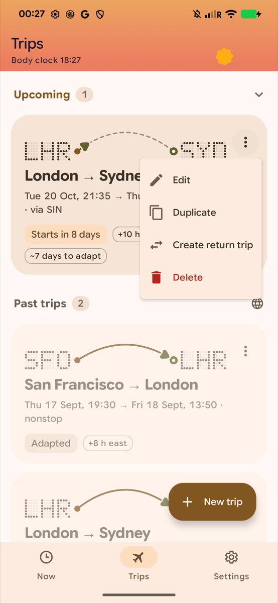
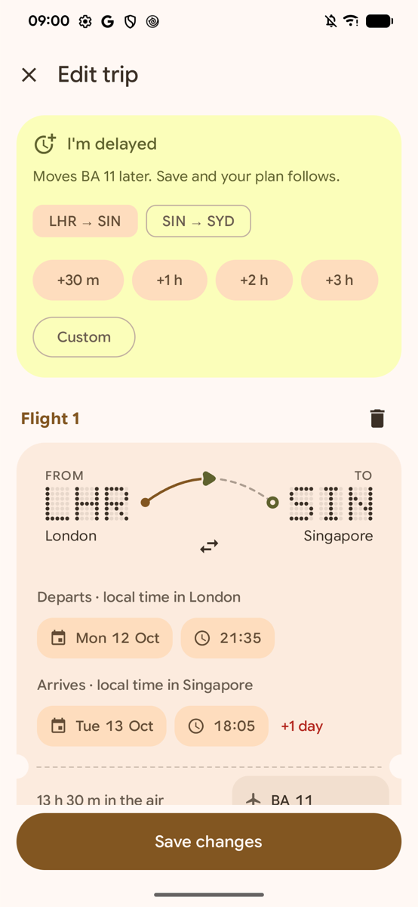

# Planning a trip

A trip is one or more flights. Add the flights with their local departure and arrival times, and the app builds
a plan straight away. You can change the trip at any time, and the plan follows.

## The Trips screen

With no trips, the screen says "Where to next?". Tap **Plan a trip** to add your own, or **Try a demo trip** to
see an example plan for a flight from San Francisco to London a few days from now.

Once you have trips, they're grouped as **In progress**, **Upcoming** and **Past**. Each card shows the airport
codes with the route drawn as an arc between them, the flight times, any stops ("1 stop · via SIN"), how many hours
the time changes ("+8 h east"), and either the day of the plan ("Day 2 of 4") or when it starts ("Starts in 8
days"). Upcoming trips also say about how many days the plan needs to adapt you ("~5 days to adapt"). Trips in
progress show how far your body clock has adapted, and while you're in the air the plane on the arc shows how far
along the flight is.

During a trip, the sky behind the screen title follows your body clock, and the subtitle shows your body clock
time.

To add another trip, tap the **New trip** button in the corner. It offers **New trip**, **Return from** the
destination of the trip you're on (or the last one you took), and **Try a demo trip**. On short windows, such as a
phone in landscape, a **+** button sits in the top bar instead, so it never covers a trip card.

## Adding flights

Each flight is a ticket: the airport codes big at the top, the departure and arrival below, and the time in the air
at the bottom.

1. Tap **FROM** on the ticket. A search sheet opens: type a city, an airport name or a three-letter code (for
   example LIS) and pick the airport. The search works offline. Before you type, the sheet offers a few popular
   airports. Each result shows the city with its country's flag, the airport name and country underneath, the
   airport's current local time (with a sun or moon for day or night) and its UTC offset. Picking your home time
   zone uses the same rows.
2. Once **From** is picked, the sheet asks for **To** straight away. Picked the airports the wrong way round? Tap
   the swap button between them. To change an airport, tap its code again.
3. Tap the departure date and time. Use the **local time at the departure airport**, as printed on your ticket.
   The label reminds you: "Departs · local time in Lisbon".
4. Check the arrival date and time, in the **local time at the arrival airport**. Once both airports and the
   departure are set, the app fills in an estimate from the flight distance, marked "Estimated from the flight
   distance". Change it to the time on your ticket. Once you've set the arrival yourself, the app leaves it alone.
   When the flight lands on another calendar day, a red **+1 day** (or **−1 day**, **+2 days**) sits next to the
   arrival.
5. The bottom of the ticket shows the time in the air ("14 h 25 m in the air"). Add the flight number there if you
   like. It's optional and only used as a label.
6. If you change planes, tap **Add connecting flight** and fill in the next ticket. With more than one flight, each
   ticket gets a heading (**Flight 1**, **Flight 2**) and a button to remove it.
7. Flying back? Turn on **Return flight** (see [Return trips](#return-trips)).
8. Tap **Build my plan** at the bottom. Until the trip is complete, the button is greyed out and the line above it
   says what's missing.

The app works out the time difference and the flight duration for you, including daylight-saving changes.

When the flights are complete, **Your shift** under the flights shows what the plan will do: how many hours the
time changes and in which direction ("+9 h east"), and about how many days it takes to adapt with the plan compared
with no plan ("About 4 days with the plan, 7 without"). It updates as you edit.

 

Once a flight has both airports, **Your shift** also shows a small globe with your route. Each flight is an arc
along the shortest path over the Earth, and each airport is a dot. The shaded half of the globe is where it's night
right now. With more than one flight, the globe turns to the flight you're editing and draws it brighter than the
others. Tap one of the other flights on the globe to scroll to its ticket. When a route wraps round the world, the
flights on the far side show through the globe as faint dashes.

Tap anywhere else on the globe to see it full size. The full-size globe labels each airport with its code.
Tap a flight there to go to its ticket, or swipe the sheet down (or go back) to close it. With TalkBack, the globe
reads out the trip, for example "Lisbon to Tokyo via Doha, 9 hours east". With more than one flight it also offers
an action per flight, such as **Go to flight 2: Doha to Tokyo**.

If you stay at a stop for three days or more, the plan treats that stop as a destination of its own and adapts
you to it before the next flight.

### When something looks wrong

The editor checks your flights as you type. Problems are marked **Fix this** (you can't build the plan until you
fix it),
**Check this** (probably a mistake) or **Note** (just information). Many come with a one-tap fix. For example, an
overnight flight entered with the same arrival date shows "Lands before it takes off" and offers **Arrives next
day?**.

## Trip details

Below the flights, **Trip details** has these settings:

- **Title**: suggested from your route. Change it if you like.
- **Body clock**: how the plan treats your body clock.
- **Body clock when you leave**: only shown when the trip leaves from a city on a different time from home. See
  [Starting away from home](#starting-away-from-home).

| Choice | What happens |
|---|---|
| Auto | Adapts you to your destination, unless you fly back within 72 hours. Then you stay on home time. |
| Adapt | Moves your body clock to destination time, even for a short stay. |
| Home time | Keeps your body clock on the time it starts on. Best for quick trips. |

In the plan, "home time" means the time your body clock is on when you leave: the first departure airport's time,
unless **Home** is picked under **Body clock when you leave**.

If every time zone change on the trip is under two hours, Auto and Adapt don't make a body clock plan: you only
get flight advice and a few nights of sleep times.

For a short trip, staying on home time is usually easier: you're back before your body could settle anyway.

### Starting away from home

Plans start from where your body clock is when you leave. Usually that's the city you fly out of. If you're
leaving from a city on a different time from your home time zone (Settings → Home time zone), **Trip details** adds
**Body clock when you leave** with two choices:

| Choice | When to pick it |
|---|---|
| Departure city | You live there, or you've been there long enough to get over jet lag. |
| Home (your home city) | You only just got to the departure city, and your body is still on home time. |

For example, if you live in Los Angeles, flew to New York two days ago and fly on to Paris tomorrow, pick **Home**:
the plan then shifts you from Los Angeles time to Paris time.

On a new trip, the app picks one for you from the route. A trip back home (its last flight lands somewhere on your
home time, like London to San Francisco for someone who lives in Los Angeles) starts on **Home**, because after a
short stay away your body is probably still on home time. Any other trip starts on **Departure city**. Pick the
other one if it fits you better: once you've picked, changing the flights doesn't change it again. A saved trip
keeps what it was saved with.

A trip that leaves from home doesn't show this choice. If it's a round trip, turn on **Return flight** and **Auto**
keeps you on home time when you're back within 72 hours.

## Return trips

The quickest way to plan the way home is the **Return flight** switch under the flights, while you add the trip
("One way / not sure yet" while it's off). Turn it on and the app suggests flying back a week after you land, at
the time of day you left. Change the date and time to your ticket's, in the local time where the trip ends. This
also lets the app spot short trips. When you tap **Build my plan**, the app adds the return trip to Trips too: the
route reversed, with the flight times copied from the way out, so check them against your ticket later with
**Edit**. If the return would leave before you land, the card says so and the plan can't be built until you fix
the date.

Editing a trip that already has a return flight only changes its date: it doesn't add a second return trip.

You can also open a trip's menu (the three dots on its card) and choose **Create return trip**, or tap **New
trip** in the corner and then **Return from** the destination. The app reverses the route and suggests times.
Check them against your ticket before you build the plan.

Either way, when the return flies you home, its body clock starts on home time (see
[Starting away from home](#starting-away-from-home)).

## Changing a trip

Tap a trip card to open its plan. (With TalkBack, "Open plan" is also offered as an action on the card.) The
three-dot menu on the card has:

- **Edit**: change flights, times or trip details.
- **Duplicate**: copy the trip, for example for a similar trip later.
- **Create return trip**
- **Delete**: removes the trip. Tap **Undo** in the message at the bottom if you change your mind.

## When your flight is delayed

From 48 hours before departure until you land, the **Edit trip** screen shows an **I'm delayed** card.

1. Pick the flight that's late (on a trip with connections, each flight has its own chip).
2. Tap how late it is: **+30 m**, **+1 h**, **+2 h**, **+3 h**, or **Custom** to type the minutes.
3. Tap **Save changes**.

The flight moves later, and the plan is rebuilt around the new times.

Next: [Following your plan](following-your-plan.md).
