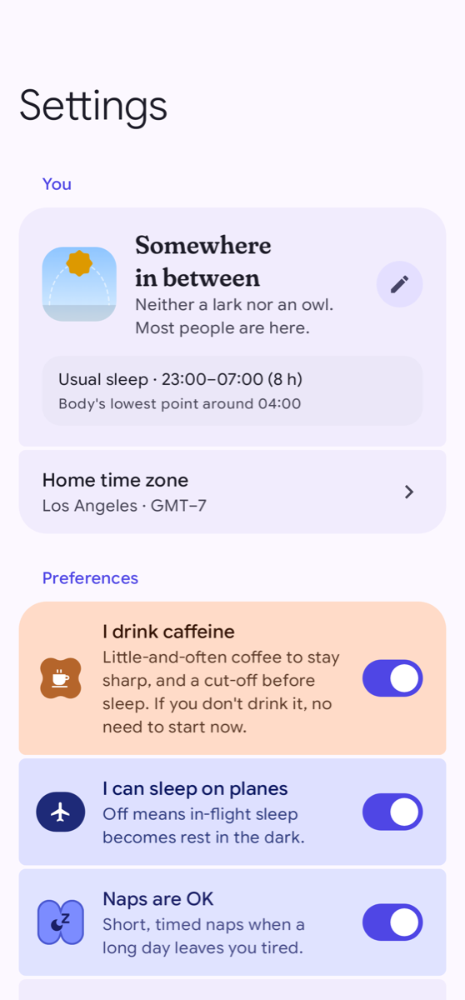
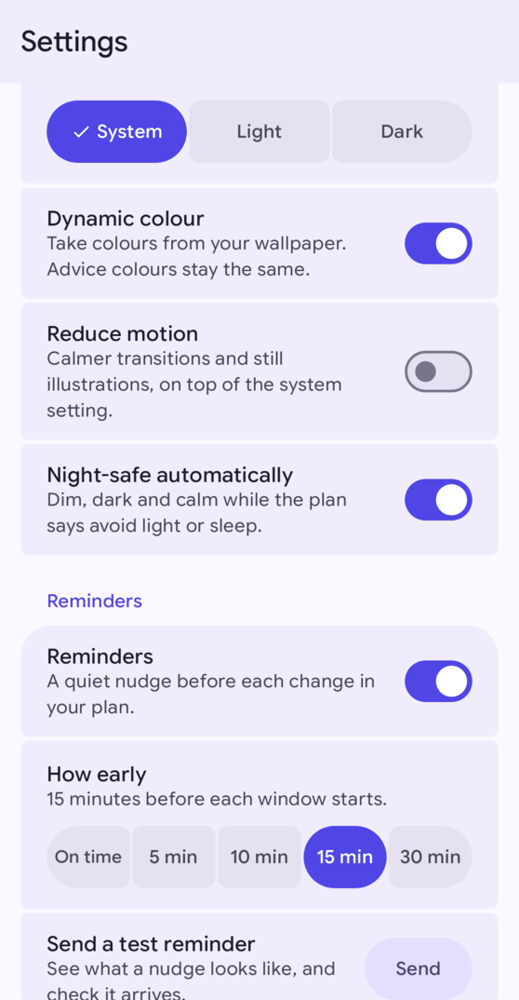
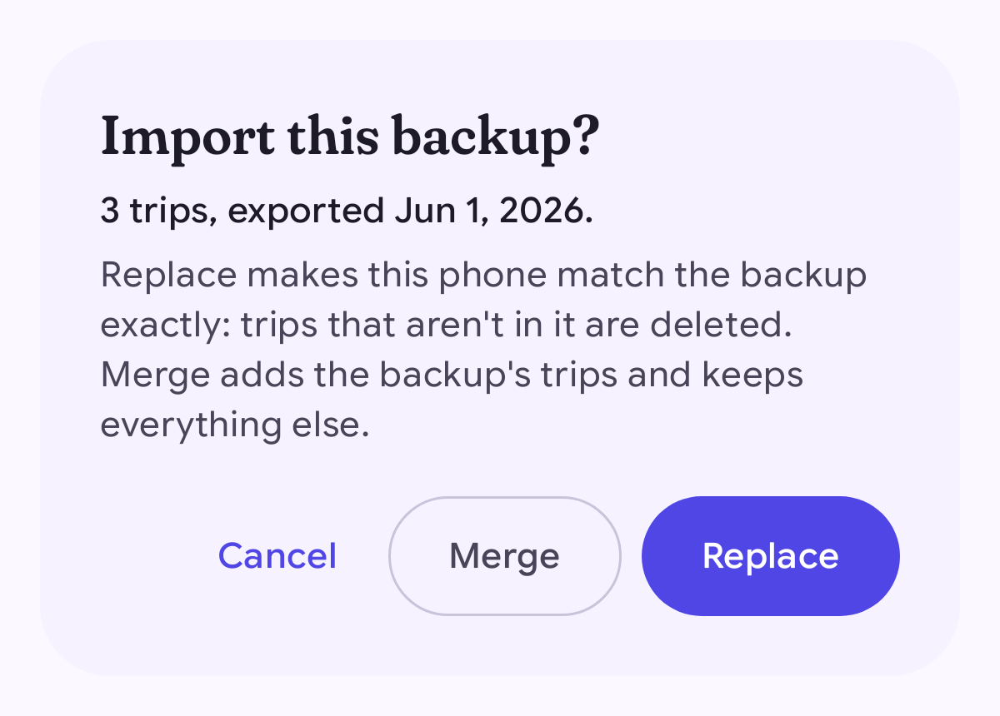

# Settings and your data

Open **Settings** from the navigation bar to change your setup answers.
Profile changes update your plans immediately. Settings also has backup, restore and appearance controls.

## You and your preferences

| Setting | What it does |
|---|---|
| You | Your chronotype, usual sleep (plus days off when different) and your body's lowest point. Tap the card to edit your sleep schedules on the two-schedule dial or pick a chronotype. See [Getting started](getting-started.md#3-when-do-you-usually-sleep). |
| Home time zone | Where home is. Search for a city or airport. When a trip leaves from a city on a different time, the trip editor lets you start its plan from home time instead ([Starting away from home](planning-a-trip.md#starting-away-from-home)). |
| Preferences | **I drink caffeine**, **I can sleep on planes**, **Naps are OK**, **Head start** (**None**, **1 day**, **2 days** or **3 days** before departure), and **I use melatonin**. See [Getting started](getting-started.md#4-your-tools). |
| How hard the plan pushes | Gentle, Balanced or Max. |

## Appearance and reminders

| Setting | What it does |
|---|---|
| Theme | System (follows your phone), Light or Dark. |
| Dynamic colour | Takes the app's colours from your wallpaper. The colours of the advice stay the same. |
| Reduce motion | Calmer transitions and still pictures, on top of your phone's own setting. |
| Night-safe automatically | Makes the plan screen dark and dim while your plan says avoid light or sleep, or during your body's night when no light is planned. The widgets turn dark while your plan says avoid light or sleep. |
| Remind me before each change | Turns all reminders and the Now notification on or off. Widgets keep working. |
| How early | When reminders arrive: on time, or 5, 10, 15 or 30 minutes before a block starts. |
| Hide details on the lock screen | Keeps places, flight numbers and supplement names off the lock screen whenever Android hides sensitive notification content, and always off widgets placed on the lock screen. Times and the kind of block stay. Off by default. See [On the lock screen](widgets-and-notifications.md#on-the-lock-screen). |
| Send a test reminder | Sends a sample reminder so you can check that reminders arrive. |
| What Android allows | A one-line summary of whether reminders can arrive on time. Tap it to see each permission: notifications, exact timing, Live Updates and battery optimisation, and tap **Allow** or **Open settings** to change one. It opens by itself when notifications or exact timing are missing. Live Updates and battery optimisation are optional extras. |
| Widgets | A preview of each home-screen widget with an **Add** button that places it on your home screen. Only shown if your home screen app supports it. |

In large windows, Settings uses two columns.
The left column contains your profile, tools, appearance and More. The right column contains reminders, widgets and data controls.

## Your data

Clockblock stores your profile, settings, trips and block check-ins on your phone.
The app has no internet access and cannot upload this data.
You can export files or share a plan summary with another app.
Android can copy the data through enabled account backups or phone-to-phone transfers.
See [Moving to a new phone](#moving-to-a-new-phone).

### Back up and restore

**Export a backup** saves your profile, settings, trips and their check-ins in a JSON file.
The export excludes check-ins for deleted trips.
Choose a save location, such as Downloads or a cloud drive app.
The filename follows this pattern: `clockblock-backup-2026-06-01.json`.

**Import a backup** reads a Clockblock backup file.
Before changing data, Clockblock lists the file's contents and asks you to choose an import mode.

- **Replace** loads the backup's profile, settings, trips and check-ins.
  It deletes local trips absent from the backup. Each restored trip gets exactly the backup's check-ins.
  It removes local check-ins absent from that backup. If the backup has no profile, Clockblock keeps the local profile.
- **Merge** adds missing trips and check-ins without deleting or replacing existing data.
  It keeps this phone's settings, existing profile and existing versions of trips and check-ins.
  It uses the backup's profile only if this phone has no profile.
  Check-ins belong to a specific plan.
  Merge adds a trip's check-ins only if the resulting trip and profile match the backup.

Clockblock rejects invalid backups and backups from newer app versions.
It explains the problem and leaves your data unchanged.

### Moving to a new phone

Android backup and phone-to-phone transfers copy your profile, settings, trips and check-ins.
They also copy options for widgets that your home screen app restores.
Android allows cloud backups with or without a screen lock. With a screen lock, Android encrypts the backup end to end.
Transfers exclude an active snooze.

Open Clockblock once on the new phone to set up reminders again.
Android does not transfer permissions. Open **What Android allows** in Settings and allow notifications and exact timing again.

For a manual transfer, export a backup on the old phone. Copy the file to the new phone and import it.

### Export a plan to your calendar

Open a plan's three-dot menu and choose **Export to calendar**.
Clockblock saves every block with its time zone in a calendar file (`.ics`). Open the file in your calendar app.
Most calendar apps update existing events when the corresponding block keeps its position in the plan.
Your calendar may retain events for removed blocks. Delete old events after a large plan change.

## More

- **Replay setup** opens the first-run questions again.
- **About Clockblock** explains the planner and lists its research sources.
  It also shows the app version and licences for its libraries, fonts and data. Tap an entry to read its licence.

Next: [Questions and answers](faq.md).
