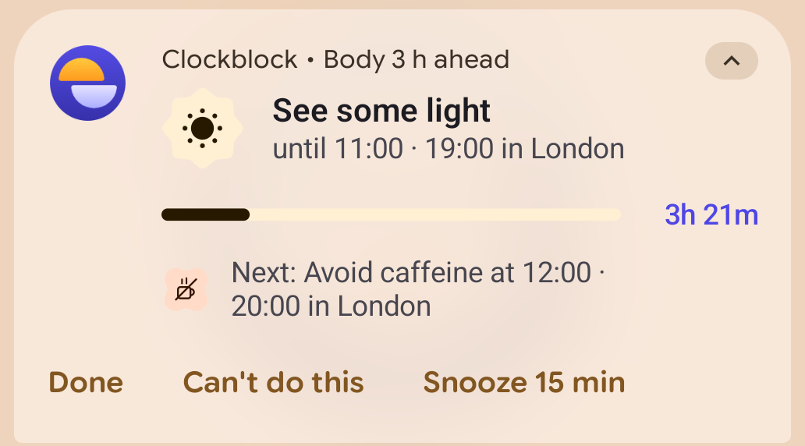
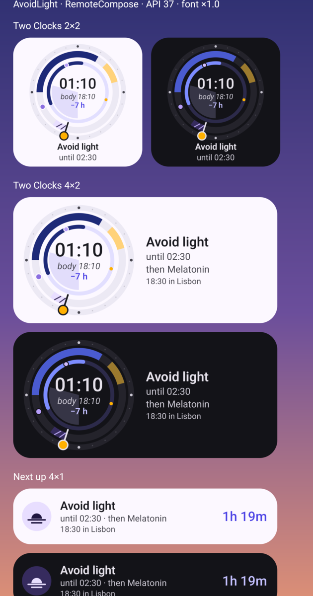
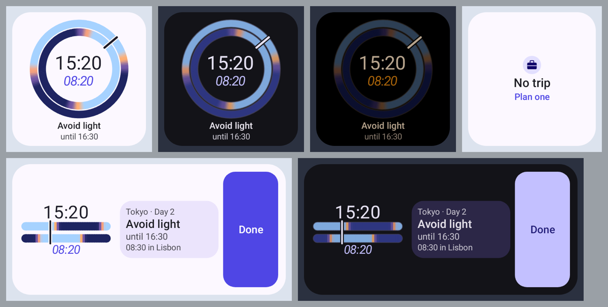
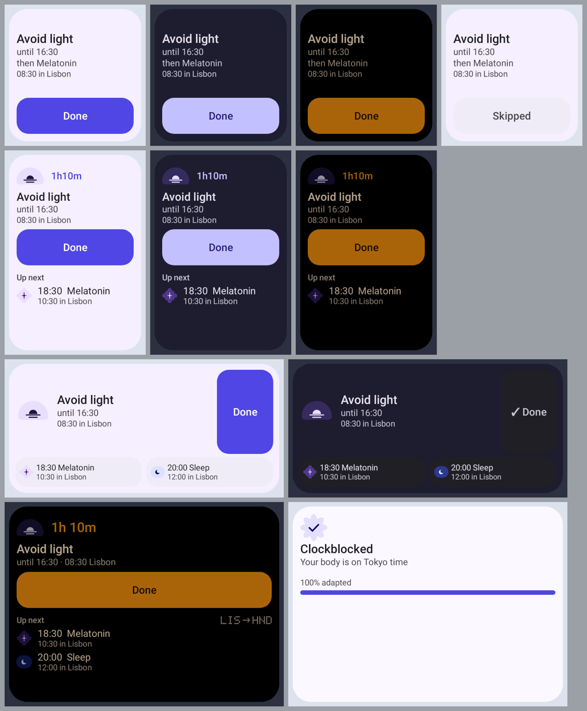
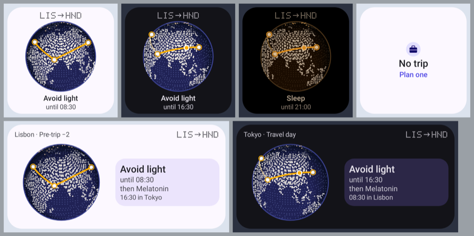
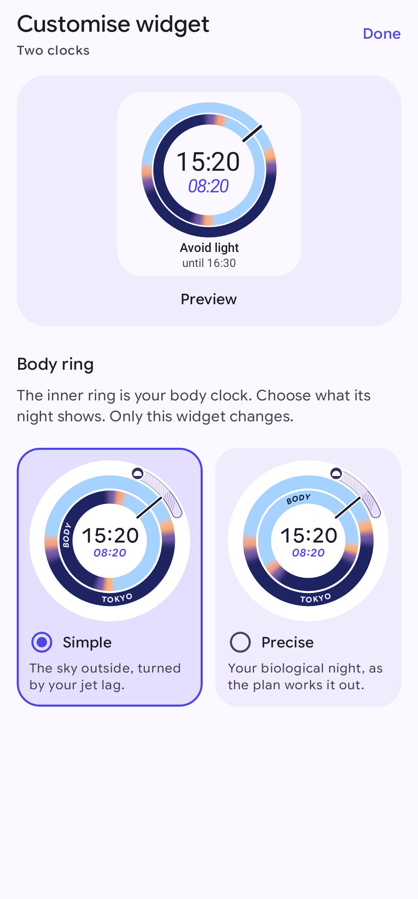

# Widgets and notifications

Clockblock shows advice through a silent ongoing notification, reminders and three home-screen widgets.
These update at each plan change and normally match the app.
Without exact-alarm permission, Android can delay updates while the phone is idle, usually by up to about an hour.
Widgets and notifications can show old advice until the update arrives.

## Reminders

Reminders give you time to prepare before a block starts.
Choose the lead time in Settings under **Reminders** → **How early**.
The choices are on time, or 5, 10, 15 or 30 minutes early. The default is 15 minutes.
Melatonin reminders arrive at dose time. Clockblock sends no flight reminders.

During planned sleep, Clockblock sends only the wake-up reminder.
It shows one reminder at a time. Blocks starting together share a reminder.

The buttons on a reminder depend on what it's for:

| Reminder | Buttons |
|---|---|
| A block that's about to start | **Can't do this** and **Snooze 15 min** |
| A melatonin dose, if you turned melatonin on | **Done** and **Snooze 15 min** |
| The wake-up reminder | none. Tap it to open the plan |

Clockblock saves reminder answers as check-ins, like answers in the app.
The Now notification offers **Done**, **Can't do this** and **Snooze 15 min** until you answer.
After a check-in, **Undo** replaces those buttons. When only a flight is active, the notification has no action buttons.

## The Now notification

During a plan, one silent notification remains in the notification shade.
It shows the advice symbol, action, end time and equivalent time in the other zone.
For example: "See some light, until 19:00 · 11:00 in Los Angeles".
Expand it for progress, remaining time and the next block.

"Until" means the block's end time, matching the app and widgets.
After a check-in, your answer appears first, such as "✓ Done · until 19:00".
Between blocks, the notification shows "Free time", its end and the next block.
The notification follows your phone's light or dark theme.

If your phone can't draw this notification, Clockblock shows a plainer version instead, with the same buttons. It
also lists anything else going on at the same time ("Also now: Avoid caffeine until 02:00") and a short tip, and
shows the other time zone only when expanded.

It updates by itself and never makes a sound. Tap it to open the plan. Its header shows how far your body clock
is from local time, for example "Body 3½ h behind", or "Body clock in sync" once you've adjusted.

The app, widgets and notifications use the plan day's time zone for local time.
They use the departure zone until arrival, then the destination zone.
The phone's time zone does not change these times, including for demo trips.
Where space allows, each view also shows the other end of the trip's time.

**Snooze 15 min** hides it for 15 minutes, then reminds you again if the block is still going.

### On the travel day

On travel days, the notification can become a **Live Update**.
Its progress bar covers about three hours before first departure through two hours after arrival.
The bar marks advice blocks, take-off and landing. Android can also show a small status-bar chip.
The Live Update requires an active advice block, such as light or sleep. A flight marker alone keeps the normal notification.
Its header gives the route and next travel event, such as "LHR → HND · Lands 19:00 · Body 8 h behind".

### On the lock screen

By default, lock-screen notifications show the same text as the shade.
Enable **Settings** → **Reminders** → **Hide details on the lock screen** to limit sensitive text.
When Android hides sensitive notification content, Clockblock shows only the block type and times.
It omits places, flight numbers, supplement names and buttons. Unlock the phone for full details.
The setting also updates any visible reminder without another vibration.

The same setting covers widgets you place on the lock screen (on tablets and in hub mode). With it on, they show
the plan day, the kind of block and its times, but no route, places, other-zone times or supplement names.
Home-screen widgets still show everything.

## Widgets

Open **Settings** → **Widgets** and tap a widget's **Add** button.
Your home screen app asks where to place it. This section appears only on launchers that support adding widgets this way.
You can also hold an empty home-screen area, tap **Widgets**, find Clockblock and drag a widget into place.
You can resize all three widgets.

### Two clocks

*Two clocks* uses the app's dial design. See [Following your plan](following-your-plan.md).
Its outer ring shows the local sky. Its inner ring shows the sky shifted to your estimated body clock time.
The needle points at local time. Central numbers show local time and italic body clock time.

Where a round dial would be too small, the widget shows the two skies as two bars instead: the top bar is the sky
where you are, the bottom bar is your body's sky, and a line crosses both at now. That's the smallest size, the
one-row sizes, and wide sizes that are only two rows tall.

Most sizes also show the current block with its end time ("Avoid light until 16:30"). The wide rows name the
nights ("Tokyo night") and say how far behind or ahead your body is ("7 h behind"). Bigger sizes add a card with
the place and plan day ("Tokyo · Day 2"), the time in your other time zone, and a **Done** button. The biggest size
also shows your route ("LIS → HND"), lists the next blocks (with their time in your other zone) and shows how far
you've adapted.

### Next up

The *Next up* widget shows the current block, with a live countdown beside its icon on the taller sizes. Bigger
sizes add the time in your other zone and a **Done** button, and the tallest and widest ones list what's up next,
next to your route ("LIS → HND"). The smallest size shows a short label, and the countdown in a block's last hour.
It says "Free time" when there's nothing to do, and "Clockblocked" when your plan is finished ("Adapted" on the
smallest size).

### Route globe

The *Route globe* widget draws your trip across a 3D day-and-night Earth, with sunlight and night-side city lights.
Before your first flight departs, it shows your whole route from start to finish, including any connections. Once
your trip is underway, it highlights the leg you're on and marks where you are along the flight.

From one day before departure through one day after arrival, the globe schedules position and lighting updates.
It updates flight position every 15 minutes and the day-and-night boundary hourly.
These updates do not wake the phone. The widget catches up when you turn on the screen.
Outside this period, it updates at plan changes like the other widgets.

On the smallest size and the one-row sizes, it shows the globe on its own. Bigger sizes add your route code
("LIS → HND") and the current block with its end time; the tallest and widest sizes add a card with the place, plan
day and the time in your other zone, plus what's up next and how far you've adapted. With **Hide details on the
lock screen** turned on, a lock-screen *Route globe* hides the route and stops and shows a calm day-and-night Earth
with only the current block's times.

### Customise a widget

Each *Two clocks* widget has its own options. Touch and hold the widget, then tap **Reconfigure** (on some home
screens it's a pencil or **Customise**). The **Customise widget** screen shows your widget as it is now, and
changes it as you choose:

- **Body ring**: what the inner ring's night shows. **Simple** (the default) is the sky outside, turned by your jet
  lag. **Precise** is your biological night, as the plan works it out.

Each widget keeps its own choice, so you can use different modes on different widgets.
Clockblock saves changes immediately. Tap **Done** or Back to finish.
Removing a widget deletes its options. Manual backup exports exclude these device-specific widget options.

### Widget actions and updates

- Tap a widget to open the plan. With no trip planned, the widgets say "No trip · Plan one", and a tap opens the
  new trip screen.
- Tap **Done** on a widget to mark the current block as done, just like the button on the notification. The button
  then turns into "✓ Done" (or "Skipped" if you skipped it elsewhere). Tapping it after that opens the plan.
- The widgets name places after your trip, the same as the route: a trip from SFO says "San Francisco", not the
  name of its time zone.
- With a screen reader, the widgets read out the times in both zones. *Next up* also says how long the current
  block has left.
- The widgets follow the app's theme. When "Night-safe automatically" is on and your plan says to avoid light or
  sleep, they switch to a black and amber look that won't light up a dark room.
- The widgets update when your plan changes and at each block boundary. They don't drain your battery by checking
  all the time.
- If a widget only says **Open Clockblock**, your launcher couldn't draw it. Tap it to open the app; the widget
  tries again at the next update.

## If reminders don't arrive

1. Open **Settings** and look at **What Android allows**. If everything needed is allowed, it shows a one-line
   summary; tap it to see each permission.
2. Make sure **Notifications** says "Allowed". If not, tap **Allow**.
3. Make sure **Exact timing** says "Allowed". Without it, reminders may arrive up to 10 minutes late, and while the phone is idle usually up to about an hour late (Android doesn't promise a limit).
4. On some phones, turning off **Battery optimisation** for the app helps too.
5. Tap **Send a test reminder** to check.

Also check that **Remind me before each change** is turned on, and that you haven't turned off one of the app's notification
categories in Android's settings. The categories are Light, Sleep & energy, Supplements & caffeine, Travel day
(live) and Now.

Next: [Settings and your data](settings-and-your-data.md).
